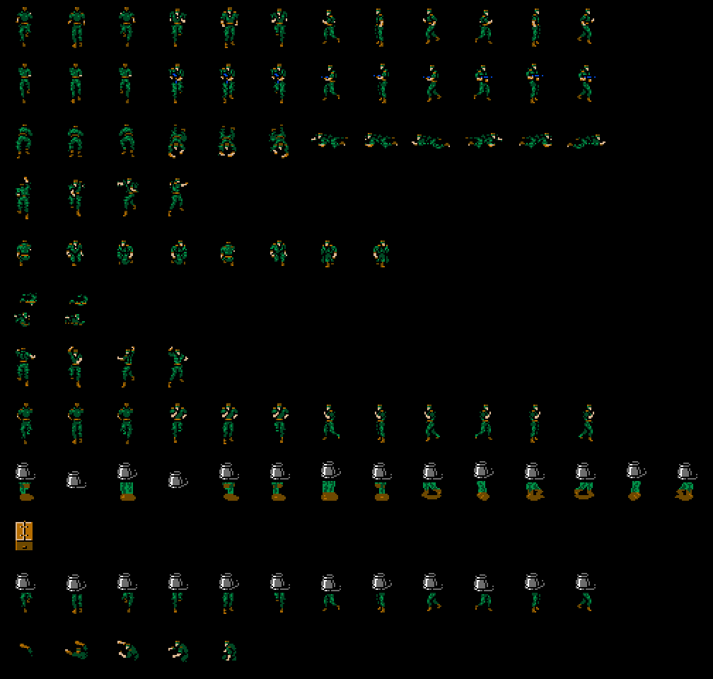
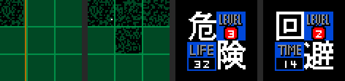

# Snake

## His drawings

Snake is **four 16 x 16 sprites**: two on top and two 16 dots lower, and in
each pair the second carries the CC bit, which adds its colours to those of
the first (`dibuja_snake`, `p12:7688`). His patterns are not fixed: every
frame the four of the drawing in use are copied into the sprite pattern table
(`0xF800`) from page 3 of the VRAM (`p12:76E9`), and his colours come, line by
line, from the runs at `p63:B282` and `p63:B620`.

The drawing is `0xCB01`, and each one chooses inside it by direction and step
(`tools/snake.py`, with the tables at `p63:B1CC-B282`). Here are the **98
different ones** that come out of going through those tables, one row per
drawing: 0-4, 7-0x0C and 0x0E (5 and 6 give no image that is not already in
another, and 0x0D puts the sprites away). Among them are walking, turning
round, the punch and crawling, 0x0B with its fixed colours (`p12:7AE5`) and
the arrival (0x0E, `p11:A090`). Playing with the emulated joystick 47 come
out, all of them among these; number 7 has not come out playing (see
[Curiosities](CURIOSITIES.html)).

Painted by the cartridge running (`tools/mg2run.py`) in room 0 of zone 0,
with its palette, checked against openMSX.

## The weapons (F2)

Snake carries his things in four-byte records: **13 weapons** at `0xD600`
and **34 pieces of equipment** at `0xD638` ([has it] [the count, in BCD]
[...]). F2 opens the weapon screen (`p10:AED6`) and F3 the equipment one
(`p10:AF30`); the sign of whatever is under the cursor comes from the table
at `p50:8046` or `p50:8048` (`letrero_de_lo_elegido`, `p10:B8C7`). Both
screens, with everything in them, are painted by the cartridge
(`tools/equipo.py`).

The F2 signs, as the ROM has them:

<!-- generado:armas -->
| Slot | | Sign |
|---:|---|---|
| 0 | | (none) |
| 1 | `p51:B546` | **ハンドガン ［ベレッタM92F］** アメリカ軍用セイシキピストルとしてサイヨウされているセミオートマチックピストル。サイレンサーソウチャクカ。タマホキュウカ。 |
| 2 | `p51:B59A` | **サブマシンガン ［イングラムM11］** アメリカのコガタケイリョウSMG。ショットキーをおしつづけるとフルオートになる。サイレンサーソウチャクカ。タマホキュウカ。 |
| 3 | `p51:B5ED` | **グレネード ［M68］** アメリカセイ、チャクハツシンカンシキハヘンシュリュウダン。ジメンにトウタツするとバクハツする。ラッカチテンはターゲット上。 |
| 4 | | (none) |
| 5 | `p51:B63B` | **タイクウミサイル ［スティンガー］** ケイタイシキ、タイクウミサイル。レーダー内のショウジュンをカーソルイドウさせ、ショットキーでハッシャする。レーダー内カノウ。 |
| 6 | `p51:B690` | **リモコンミサイル ［M47ドラゴン］** シュ動モクシセン指令ホウシキによりハッシャゴのミサイルとモクヒョウをモクシによるカーソルソウサでホウコウをシュウセイできる。 |
| 7 | `p51:B6E7` | **プラスチック・バクダン** ヘンケイカノウなケイリョウコウセイノウバクヤク。 |
| 8 | `p51:B70E` | **ジライ ［M 78］** ショットキーでセット、ホフクで真上を通るとカイシュウ。タンチキがあればレーダー上にうつる。レーダー内にサイダイ16コセットカ。 |
| 9 | `p51:B808` | **カモフラージュ・マット ［ファントム07］** あらゆるVRAMにタイオウできるカモフラージュ・マット。ショットキーでセット、真上を通るとカイシュウ。下に潜れば見えなくなる。 |
| 10 | `p51:B761` | **ムリョク化ガス ［ABC M25A2］** ボウドウチンアツ用シュリュウダン。バクハツするとCN1ガスをかざ下にフンシュツする。かざ上でのシヨウはキケン。 |
| 11 | `p51:B7B3` | **マウス ［ジェリー2］** シカケやセンサーを発見するのにつかうダミーロボット。物音モードのカイジョにもつかえる。ショットキーでプレイヤーの前方へはしる。 |
| 12 | `p51:B866` | **ライター ［JR TOKAI］。** どこにでもうっている100エンライター。シヨウホウホウはフメイ。 |
| 13 | | (none) |
<!-- /generado -->

## The equipment (F3)

<!-- generado:equipo -->
| Slot | | Sign |
|---:|---|---|
| 0 | | (none) |
| 1 | `p51:B89A` | **タバコ ［ラッキー・ストライカー］** ゼンカイにひきつづき、SNAKEアイヨウのタバコ。コドクな戦場にはイキヌキもヒツヨウ。しかし・・・真のシヨウホウホウはフメイ。 |
| 2 | `p51:BA39` | **ソウガンキョウ ［ニコス F500］** これをつかうとプレイヤーを中心に上下左右のガメンを見ることができる。 |
| 3 | `p51:BB19` | **ナイトビュア** クラヤミでも真ヒルのように見えるアンシゴーグル。これをソウビすればいかなるクラヤミでも見えるようになる。 |
| 4 | `p51:B943` | **ガスマスク［ライアット・フェイス・マスク］** これをソウビするとドクガス・エリアでO2ゲージが2バイになり、へり方もおそくなりタイキュウ時間がのびる。ムリョク化ガスにもカ。 |
| 5 | `p51:B8F2` | **ボディ・アーマー ［S・P・S］** テキからのダメージがハンゲンするボウダンチョッキ。サイレント・パートナー・スペシャルといわれ、ジュウダンにのみユウコウ。 |
| 6 | | (none) |
| 7 | `p51:B9E7` | **サンソボンベ** これをソウビすると水中でのO2ゲージが2バイになり、へり方もおそくなり潜水時間がながくなる。水上に上がればマンタンにもどる。 |
| 8 | `p51:B99F` | **ジライタンチキ** これをソウビするとジライがレーダー上にしろいコウテンとなってうつる。プレイヤーのしかけたジライもドウヨウにハンノウする。 |
| 9 | `p51:BAF4` | **ハングライダー** 戦場でのリヨウカチはなし。シヨウホウホウはフメイ。 |
| 10 | `p51:BA77` | **ダンボール** タッキュウビンのどこにでもあるようなダンボールのハコ。ザンジバーランドいきのデンピョウがはられている。シヨウホウホウはフメイ。 |
| 11 | `p51:BABF` | **バケツ** トイレそうじ用のカネセイのゴミバケツ。かなりじょうぶなシロモノだ。シヨウホウホウはフメイ。 |
| 12 | `p51:BBF4` | **カゼグスリ ［PLカル ホワイト］** エン化リゾチームハイゴウのビエン用カゼグスリ。くしゃみ、はな水、はなづまり、なみだ目にきく。15サイ以上、1かい、1カプセル。 |
| 13 | `p51:BB84` | **カセットテープ** ナターシャのロッカーにあったカセットテープ。ザンジバーランドのコッカがロクオンされている。 |
| 14 | `p51:BB5A` | **タマゴ** バイオラボにあったタマゴ。たべられそうにはない。シヨウホウホウはフメイ。 |
| 15 | `p51:BB5A` | **タマゴ** (= 14) |
| 16 | `p51:BC4E` | **ブローチ** ナターシャがくれたブローチ。ザンジバーランドのマークがモチーフされている。シヨウホウホウはフメイ。ナターシャのにおいがする。 |
| 17 | `p51:BD04` | **レッド・カード** カード1から3をダイヨウするマスター・カード。 |
| 18 | `p51:BD25` | **ブルー・カード** カード4から6をダイヨウするマスター・カード。 |
| 19 | `p51:BD46` | **グリーン・カード** カード7から9をダイヨウするマスター・カード。 |
| 20 | `p51:BCE7` | **カード** ザンジバーランドでシヨウされているICカード。 |
| 21 | `p51:BCE7` | **カード** (= 20) |
| 22 | `p51:BCE7` | **カード** (= 20) |
| 23 | `p51:BCE7` | **カード** (= 20) |
| 24 | `p51:BCE7` | **カード** (= 20) |
| 25 | `p51:BCE7` | **カード** (= 20) |
| 26 | `p51:BCE7` | **カード** (= 20) |
| 27 | `p51:BCE7` | **カード** (= 20) |
| 28 | `p51:BCE7` | **カード** (= 20) |
| 29 | `p51:BC94` | **スプレー ［ミセス・スプレー］** ジメチエーテル、LPガスをつかったキョウネンセイのラッカー用スプレー。カキゲンキンとかかれている。イロはメタリックグレイだ。 |
| 30 | | (none) |
| 31 | `p51:BBBC` | **カートリッジ** マルフののこしたゲームカートリッジ。この中にOILIXのマイクロフィルムがかくされている。 |
| 32 | `p51:BD68` | **Cレーション ［B1ユニット］** ショットキーでタイリョクのカイフクができるギュウニク、ブタニク、ハムエッグ、ツナフィッシュ、チョコレート、クラッカーをふくむ。 |
| 33 | `p51:BDBB` | **Cレーション ［B2ユニット］** ショットキーでタイリョクのカイフクができるマメとミートボールのトマトニ、マメとフランクフルト、ギュウニクのポテトニをふくむ。 |
| 34 | `p51:BE0D` | **Cレーション ［B3ユニット］** ショットキーでタイリョクのカイフクができるスライスハム、ニワトリとシチメンチョウ、スパゲッティ、チーズ、コーヒーをふくむ。 |
| 35 | | (none) |
| 36 | `p51:AD99` | **ービルのエレベーターこうをのぼっていっ** たわ{FB}1{76}オクジョウか？！{FB}{78}ここの連中もヒッシになってさがしているわ。カレらよりはやくつかまえないと、マルフ博士のユイイツのてがかりよ{FB}{76}ハトさがしか？・・・キミはどうする？{FB}{78}わたし、足でまといになるわ。もうすこしジョウホウをあつめたいしね。ヒョウカ下がってるのよ。ここんとこ・・・それに、こんな目にあったんですもの。{FD}このままではおさまらないわ！{FB}{76}こころづよいな・・・ムリはするなよ{FB}{78}トウチョウされるといけないからシュウハスウかえるわね。140・76ね。SNAKE{FB}{78}それから、カードをコピーしておいたわ。カード4、つかって・・・{FB}{78}じゃあね、SNAKE・・・またあとで{FB}1{76}ホーリー！{FB}2{78}えっ？・・・{FB}{76}今のは、恋人同士のわかれのコトバだ{FB}{78}・・・じゃあ、私たちは？・・・なんて言うの？{FB}2{76}いきていればいつでもあえる・・・{FB}2{78}・・・・わかったわ{FB}2{76}こちらSNAKE・・・潜入ポイントにトウチャク{FB}2{77}SNAKE・・・あいかわらず、時間通りだな{FB}2{77}よし・・・OPERATIONINTRUDE　F014カイシ{FD}もういちど、カクニンする。きみのニンムはザンジバーランドに潜入、ラチされているチェコの生物学者キオ・マルフをダッシュすること{FD}SNAKE、コンカイのシンヘイキ動体はんのうセンサーのスイッチを入れてみろ{FB}2{76}ラジャー・・・スイッチをいれる |
| 37 | `p51:AEBC` | **。** カード4、つかって・・・{FB}{78}じゃあね、SNAKE・・・またあとで{FB}1{76}ホーリー！{FB}2{78}えっ？・・・{FB}{76}今のは、恋人同士のわかれのコトバだ{FB}{78}・・・じゃあ、私たちは？・・・なんて言うの？{FB}2{76}いきていればいつでもあえる・・・{FB}2{78}・・・・わかったわ{FB}2{76}こちらSNAKE・・・潜入ポイントにトウチャク{FB}2{77}SNAKE・・・あいかわらず、時間通りだな{FB}2{77}よし・・・OPERATIONINTRUDE　F014カイシ{FD}もういちど、カクニンする。きみのニンムはザンジバーランドに潜入、ラチされているチェコの生物学者キオ・マルフをダッシュすること{FD}SNAKE、コンカイのシンヘイキ動体はんのうセンサーのスイッチを入れてみろ{FB}2{76}ラジャー・・・スイッチをいれる |
<!-- /generado -->

## The radar

The box on the right (`pon_radar`, `p12:6F49`) draws the **3 x 3 rooms**
around Snake's from the map at `0xD900` (`fondo_del_radar`, `p12:6EC8`), a
line that sweeps it (`p12:6D78`) and, at the end of each sweep, a dot for each
enemy (`p12:6CE0`).

When an enemy sees Snake (`alerta_sin_musica`, `p04:9955`) the radar is
replaced by alert 2: **危険** with LEVEL and LIFE; with alert 1 (`p04:934C`),
**回避** with LEVEL and TIME. LEVEL is the alert plus one (at most 3); LIFE,
Snake's life (`0xCA53`); TIME, the count `0xD42B` divided by 8
(`rotulos_de_alerta`, `p04:984C`). The four pictures above are painted by the
cartridge (`tools/radar.py`) in room 2 of zone 6.
