# The bosses

The boss fights are not actors: they are **0x20-byte records at `0xD800`**
(four of them; in the special rooms, the one at `0xD860`). On entering a
zone, `fichas_d800_de_la_zona` (`p12:6BA5`) fills them from the `p56` rows
[kind] [Y] [X] [row] [column] [life]. There are **11 kinds**: each one's
drawing goes through the table at `p04:8A75` and its logic through the one at
`p04:8A8D`; when it runs out of life (`resta_a_d800`, `p07:B471`) it moves on
to steps 0x20 and on (`p04:8AD8`).

Each fight is **played by the cartridge running** (`tools/jefes.py`): its zone
and room are entered, Snake is put where the fight starts and the game's
whole frame, the interrupt's (`p01:728E`), is run, with the messages passed
with the trigger and Snake's life kept full; at the end the boss's life is
taken away to see how it ends. The pictures are the play area (0xC0 x 0xC0
dots), in order: the arrival, the fight and the end.

Each one's name comes from its messages ([The texts](THE-TEXTS.html)).

## 0x01, HIND D (zone 0x07)

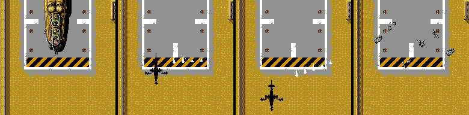

The helicopter on the pad. It is made of screen characters, not sprites,
with its shadow; when it dies it ends like the missiles (steps 0x20 and
0x2A-0x2D). ケスラー names it: «HIND・D» (`p49:AF2E`).

## 0x02, METAL GEAR (zone 0x12)

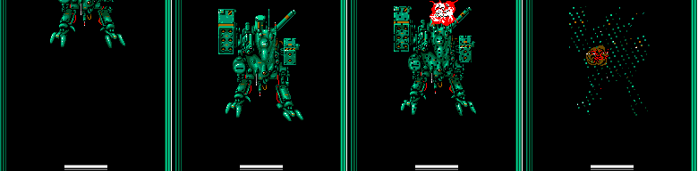

The robot, made of characters, on a **split screen**: the fight on top with
its vertical scroll and the status panel below, by changing register R#23
halfway down the screen. In this zone the game puts Snake in room 3
(`p00:5ADF`), and the fight is entered in room 8 through door 8, of kind 5;
the robot is drawn only once (`p04:88B7`). The split screen, put together the
way the line interrupt puts it, is checked against openMSX: 224 dots
different out of 54,272, a thrown object and the life bar. Snake calls it
«シンガタMETAL GEAR», the new METAL GEAR (`p50:9182`).

## 0x03, BLACK COLOR (zone 0x03)

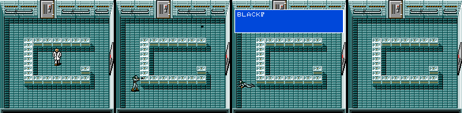

The scientist who transforms. His messages are signed «BLACK COLOR»
(`p50:8807`), and `p50:887B` says who he is: Kyle Schneider.

## 0x04, RUNNING MAN (special room 0x29)

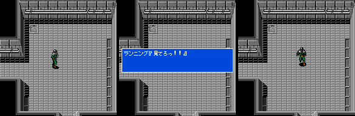

«オレはRUNNING MAN» (`p50:8BDA`). In the cartridge running, the fight stays
in the message of its step 0x10, «見てろっ！！».

## 0x05, NIGHT SIGHT (zone 0x13)

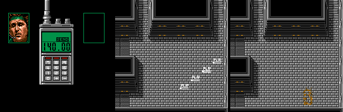

It starts with a transceiver call. ケスラー names it (`p49:B233`). When it
dies it brings out the record of kind 8.

## 0x06, RED BLASTER (zone 0x0E)

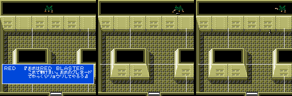

«おれはRED BLASTER» (`p50:8D64`).

## 0x07, PREDATOR (zone 0x0A)

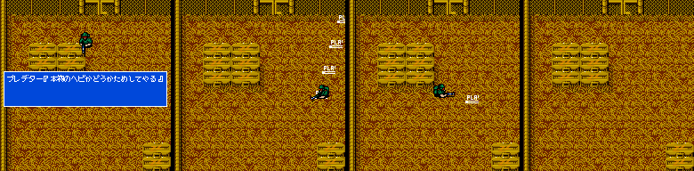

«プレデター『本物のヘビかどうかためしてやる』» (`p50:8D95`).

## 0x08, Pettrovich (zone 0x13)

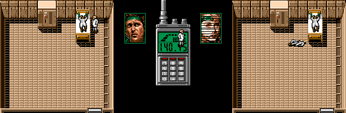

ペトロビッチ・マッドナー, the doctor: his messages are 0x14-0x17 of
`p50:8E35-9182` and ケスラー gives his full name (`p49:B61E`). The record
stays in its step 0x11, which waits for an event of the game (bit 5 of
`0xD7D9`, `p05:BFA0`).

## 0x09, GREY FOX (zone 0x12)

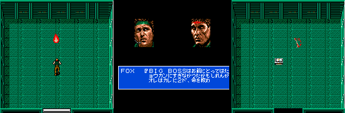

With his conversation (`p50:990C`). «GREY FOX», spelt like that, in the
texts. His steps 5 to 0x10 wait for events of rooms 2 and 3 (`0xD88C`).

## 0x0A, BIG BOSS (zone 0x12)

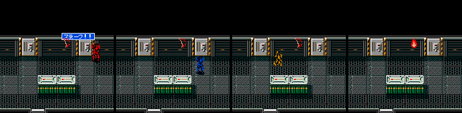

His messages, `p50:92BB` and `p50:92FF`. Step 0 waits for `0xD6B0`: in the
cartridge running he is seen from the moment his life is taken away.

## 0x0B, ULTRABOX (zone 0x0B)

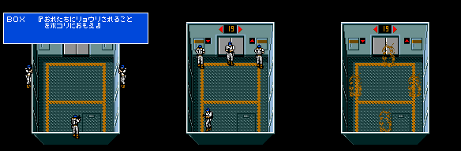

Four at once, inside the lift: on reaching floor 0x13 (`p07:A248`) step 0x0F
sets `0xD8A0` and the four records come out (`p05:AA90`) with their scene
(`p05:AB08`). «BOX『おれたちにリョウリされることをホコリにおもえ』»
(`p50:8DE4`). They burn when they die.

## The music

The fights of kinds 2, 3, 4, 6, 7 and 0x0A and the ULTRABOX one play tune
**0x84**; the HIND D one, **0x91** ([The music](THE-MUSIC.html)).
