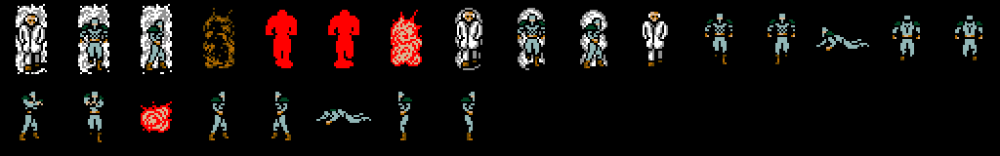
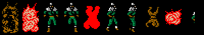
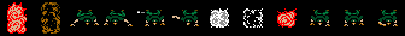
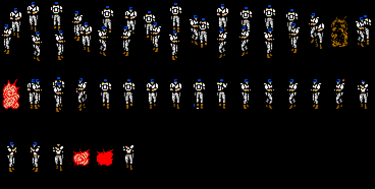
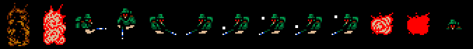
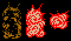
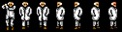
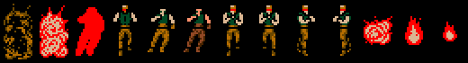
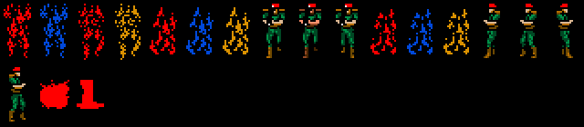

# The bosses

The boss fights are not actors: they are **0x20-byte records at `0xD800`**
(four of them; in the special rooms, the one at `0xD860`). On entering a
zone, `fichas_d800_de_la_zona` (`p12:6BA5`) fills them from the `p56` rows
[kind] [Y] [X] [row] [column] [life]. There are **11 kinds**: each one's
drawing goes through the table at `p04:8A75` and its logic through the one at
`p04:8A8D`; when it runs out of life (`resta_a_d800`, `p07:B471`) it moves on
to steps 0x20 and on (`p04:8AD8`), and at the end it leaves its mark
(`p06:B155`): the game flags and, for some, the phase.

## The order

It is given by the **game phase** (`0xCA22`), which the ends of the fights
raise: BLACK COLOR sets it to 1, RUNNING MAN to 2, the HIND D to 3, the
ULTRABOX to 6 and Pettrovich to 9 (`p06:B16B-B1CA`); 4 is set by a
conversation (`p06:AF9D`), 5 by the end of scene 5 (`p09:ADC7`) and 8 by the
owl in zone 0x0A (`p05:A0C5`, see [Curiosities](CURIOSITIES.html)). No code
writes 7: it is only read when a saved game is loaded (`p12:635A`). And two
chains in the code: when NIGHT SIGHT dies Pettrovich comes out, and after
METAL GEAR come GREY FOX and BIG BOSS (`p04:8C23-8CFB`). RED BLASTER and
PREDATOR do not touch the phase: their place in the list is that of their
zone in the game, not measured.

## How they are made

Each fight is **played by the cartridge running** (`tools/jefes.py`): its
zone and room are entered, the game's whole frame (`p01:728E`, the
interrupt's) is run with Snake's life kept full; each message is passed with
the trigger after 30 frames (2.5 s on the MSX), once it has been written, and
after 600 frames of play (not counting those with messages and calls) the
boss's life is taken away to see how it ends. Whatever the fight waits for
from the player (coming close, picking something up) is told in each one. The GIFs go **at the MSX's pace**: while playing, the game processes
one frame every 5 of the VDP (measured in openMSX, see
[Under the hood](UNDER-THE-HOOD.html)). A still picture longer than 4 seconds
(a message waiting) is left at 4.

Under each GIF, its sprites with no repeats: the loose pieces of sprites 8-31
of each frame (the boss, its shots, its explosions), each one once. The HIND D
and METAL GEAR have none: they are made of screen characters, not sprites.

The bosses' patterns are loaded by the game when the opening call ends
(`p09:B82F`): checked against openMSX in PREDATOR's room, identical.

## 1. BLACK COLOR (zone 0x03)

The scientist who transforms. His messages are signed «BLACK COLOR»
(`p50:8807`), and `p50:887B` says who he is: Kyle Schneider.

## 2. RUNNING MAN (special room 0x29)

«オレはRUNNING MAN» (`p50:8BDA`). He runs through the rooms of his special
room; when he gives up (step 0x0F, `p05:AF32`) he stays in the middle and
waits for Snake to come close (step 0x10, `p05:AF59`: 0x20 dots in X): here
Snake goes to his room leaving through the top, as the player would. Then he
says «・・・SNAKE？チータがヘビにまけた・・なぜ？» (`p50:8CBF`) and burns (steps
0x20-0x23).

## 3. HIND D (zone 0x07)

The helicopter on the pad. It is made of screen characters, not sprites,
with its shadow; when it dies it ends like the missiles (steps 0x20 and
0x2A-0x2D). ケスラー names it: «HIND・D» (`p49:AF2E`).

## 4. RED BLASTER (zone 0x0E)

«おれはRED BLASTER» (`p50:8D64`), with his grenades.

## 5. ULTRABOX (zone 0x0B)

Four at once, inside the lift: on reaching floor 0x13 (`p07:A248`) step 0x0F
sets `0xD8A0` and the four records come out (`p05:AA90`) with their scene
(`p05:AB08`). «BOX『おれたちはみっ室専門のアンサツブタイULTRABOXだ』»
(`p50:8DE4`). They burn when they die.

## 6. PREDATOR (zone 0x0A)

«プレデター『本物のヘビかどうかためしてやる』» (`p50:8D95`).

## 7. NIGHT SIGHT (zone 0x13)

It starts with a transceiver call. ケスラー names it (`p49:B233`). He is
not seen in the fight: he wears «the latest camouflage suit, stealth» and a
gun that makes no sound (`p49:B9BA`). When it dies it brings out the record of
kind 8. Checked against openMSX entering his room (`tools/omsx_salas.tcl`,
zone 0x13 row 1 column 8): the same call, «オレだ・・・ファンのー人だ。SNAKE、気をつけろ。»
(`p49:B957`) on 140.00, and then nothing but his shots in the room, as here.

## 8. Pettrovich (zone 0x13)

ペトロビッチ・マッドナー, the doctor: his messages are 0x14-0x17 of
`p50:8E35-9182` and ケスラー gives his full name (`p49:B61E`). He talks about
Marv's MSX cartridge, ホーリー calls, he confesses («ペトロビッチ、お前がマルフ博士を？»,
`p50:8FC4`), fights hand to hand and, dying, tells Snake how to destroy METAL
GEAR (`p50:9182`). His step 0x11 (`p05:BFA0`) waits for bit 5 of `0xD7D9`,
set by picking up thing 0x2D (`bandera_por_cosa`, `p10:A68C`): Marv's
cartridge, record `0xD6B0`. Here it is given as if picked up.

## 9. METAL GEAR (zone 0x12)

The robot, made of characters, on a **split screen**: the fight on top with
its vertical scroll and the status panel below, by changing register R#23
halfway down the screen. In this zone the game puts Snake in room 3
(`p00:5ADF`), and the fight is entered in room 8 through door 8, of kind 5;
the robot is drawn only once (`p04:88B7`). The split screen, put together the
way the line interrupt puts it, is checked against openMSX: 224 dots
different out of 54,272, a thrown object and the life bar. Snake calls it
«シンガタMETAL GEAR», the new METAL GEAR (`p50:9182`).

## 10. GREY FOX (zone 0x12)

«GREY FOX», spelt like that, in the texts. He takes the cartridge and leaves
Snake burning; キャンベル tells him to throw away all his equipment and
weapons (`p48:9DB3`). Step 5 (`p05:B9F3`) waits until he carries nothing
(`0xD88C`, set by `cb4b_sin_cosas`, `p10:BBDD`, when F2 or F3 opens) and for
Snake in room 3; step 6, in room 2. Here his things are emptied and he is
taken to those rooms as the player would go. Then both men's messages
(`p50:9866`: «FOX！キサマのくさりきったショウネをたたききなおしてやるっ！»), the
fist fight (step 0x0A) and the final conversation (`p50:990C`). In
openMSX he is reached by losing in zone 0x12 and continuing
(`zona_12_con_d888`, `p14:B0BA`; `tools/omsx_bigboss.tcl` with
`BB_JEFE=fox`): his record at `0xD820`, his message «SNAKE！カートリッジはもらっていくぞ、»
(`p50:9C93`) and Snake burning, as at the start of this GIF; that way he
stays in his step 5, so the rest of the fight is not checked.

## 11. BIG BOSS (zone 0x12)

His messages, `p50:92BB` and `p50:92FF`. The fight is started by
`zona_12_con_d889` (`p14:B104`), the way the game comes back into zone 0x12
after GREY FOX: Snake with nothing he carried, `0xD8A9` = `0xD6B0` = 1 and BIG
BOSS's record at `0xD840`. His step 2 tells Snake something in room 1 and step
4 waits for him in room 6 (`p05:B608`), where he arrives, they talk with both
portraits (`p50:92BB`...) and he starts looking for him (step 8). Checked
against openMSX arriving the same way (`tools/omsx_bigboss.tcl`: losing in
zone 0x12 and CONTINUE): BIG BOSS's record and sprites at his step 6,
identical. When his life is taken away he flashes blue, orange and red.

## The music

The fights of kinds 2, 3, 4, 6, 7 and 0x0A and the ULTRABOX one play tune
**0x84**; the HIND D one, **0x91** ([The music](THE-MUSIC.html)).
