# The enemies

The enemies are **actors** of the zone, not of the room: each one carries its
row and its column and goes from room to room. There are 24 records of 0x40
bytes at `0xCE00`; the last four (`0xD300`) are those that arrive with the
alert (`p14:B20E`). On the maps there are **155** in the rooms and **52** in
the special rooms, in their starting place ([The maps](THE-MAPS.html)).

Each kind has its routine (`p04:815B`, from 1 to 0x18) and its drawing table
at `p56:A808`: a width and, behind it, a row of [offset] [pattern] pairs per
drawing, which `sprites_de_actores` (`p12:7DDC`) puts with the sprites and
colours it is given (`p04:81C5`). The soldiers share the table (`p56:A852`):
what tells them apart is each zone's colours.

## How they are made

Each enemy of each room is **played by the cartridge running**
(`tools/enemigos.py`): its room is entered, 120 frames of the whole game
(`p01:728E`) are run and only its sprites are painted, in a 64 x 64 dot box
that follows it. So that they patrol and don't chase Snake, the alert
(`0xCA5F`) is set to zero every frame. The GIFs go **at the MSX's pace** (one
game frame every 5 of the VDP, measured in openMSX). There is one for each
different look (kind, patterns and colours); the identical ones are counted.

<!-- generado:enemigos -->
### 1. Soldier (kind 0x01)

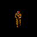

Played in zone 00, room 01; the same in 66 more rooms.

### 2. Soldier (kind 0x02)

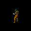

Played in zone 01, room 13.

### 3. Soldier (kind 0x04)

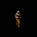

Played in zone 03, room 00; the same in 8 more rooms.

### 4. Soldier (kind 0x01)

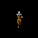

Played in zone 03, room 03.

### 5. Soldier (kind 0x01)

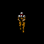

Played in zone 03, room 08; the same in 7 more rooms.

### 6. Soldier (kind 0x05)

Played in zone 03, room 10.

### 7. Small figure with pigtails (kind 0x11)

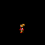

Played in zone 04, room 05; the same in 10 more rooms.

### 8. Soldier (kind 0x09)

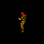

Played in zone 04, room 08.

### 9. Soldier (kind 0x06)

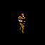

Played in zone 04, room 16.

### 10. Blue dome (kind 0x13)

Played in zone 06, room 01; the same in 31 more rooms.

### 11. Small figure in a red cap (kind 0x10)

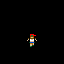

Played in zone 06, room 02; the same in 20 more rooms.

### 12. 48 x 48 dot machine (kind 0x14)

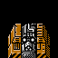

Played in zone 08, room 03; the same in 3 more rooms.

### 13. Soldier (kind 0x01)

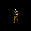

Played in zone 0A, room 14; the same in 2 more rooms.

### 14. Bird (kind 0x16)

Played in zone 0F, room 03.

### 15. Small animal (kind 0x12)

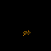

Played in special room 39, room 01; the same in 10 more rooms.

### 16. Camera (kind 0x15)

Played in zone 01, room 0A; the same in 9 more rooms.

### 17. Soldier (kind 0x0C)

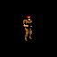

Played in zone 01, room 0D; the same in 4 more rooms.

### 18. Soldier (kind 0x01)

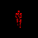

Played in zone 03, room 11; the same in 2 more rooms.

### 19. Soldier (kind 0x0A)

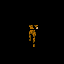

Played in zone 04, room 0D; the same in 2 more rooms.

### 20. Soldier (kind 0x0A)

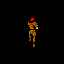

Played in zone 04, room 0D; the same in 5 more rooms.

### 21. Camera (kind 0x15)

Played in zone 05, room 00; the same in 2 more rooms.

### 22. A 4 x 4 dot, with the birds (kind 0x17)

Played in zone 0F, room 03.
<!-- /generado -->

## The ones in no room

Kinds 0x03, 0x08, 0x0B, 0x18 and 0x19 have their drawing table but are in no
room's list. Kind 0x0B is created by an event (`p12:6B0B`: at `0xD340`, with
Y = 0x20 and X = 0xA0); kind 8 is removed by `tipo_8_fuera` (`p12:6930`)
unless two game flags are set. The four of the alert (`0xD300`) arrive when an
enemy sees Snake; how many is counted by `cuantos_pueden_llegar` (`p14:B233`)
from Snake's level and the actors in the room. Those are not played here.
