# The enemies

The enemies are **actors** of the zone, not of the room: each one carries its
row and its column and goes from room to room. There are 24 records of 0x40
bytes at `0xCE00`; the last four (`0xD300`) are those that arrive with the
alert (`p14:B20E`). On the maps there are **155** in the rooms and **52** in
the special rooms, in their starting place ([The maps](THE-MAPS.html)).

Each kind has its routine (`p04:815B`, from 1 to 0x18) and its drawing table
at `p56:A808`: a width and, behind it, a row of [offset] [pattern] pairs per
drawing, which `sprites_de_actores` (`p12:7DDC`) puts with the sprites and
colours it is given (`p04:81C5`). The soldiers share the table (`p56:A852`):
what tells them apart is each zone's colours.

## How they are made

Each enemy is **played by the cartridge running** (`tools/enemigos.py`):
its room is entered and 120 frames of the whole game (`p01:728E`) are run;
what you see is the whole room, as on screen, with Snake standing still. So
that they patrol and don't chase Snake, the alert (`0xCA5F`) is set to zero
every frame. The GIFs go **at the MSX's pace** (one game frame every 5 of the
VDP, measured in openMSX). There is one per different look: all the
soldiers (kinds 1-9, 0x0A and 0x0C) are one class, told apart by their
colours, and a soldier whose colours are all in another one's (seen from
behind) is the same soldier. The room of each GIF is the one where it moves
the most.

Checked against openMSX (`tools/omsx_salas.tcl` with a dump every 0.4 s, eight
rooms): the cameras slide along the wall and the soldiers asleep in room 0x0D
of zone 4 are drawn in their beds with the background, not with sprites. The
first version of this page painted each enemy in a box that followed it: the
cameras came out still, and the sleeping soldier was given sprites by force
and came out headless.

## All their drawings

The different drawings of the enemy in each GIF below, one row per enemy, in
the same order and with no repeats:

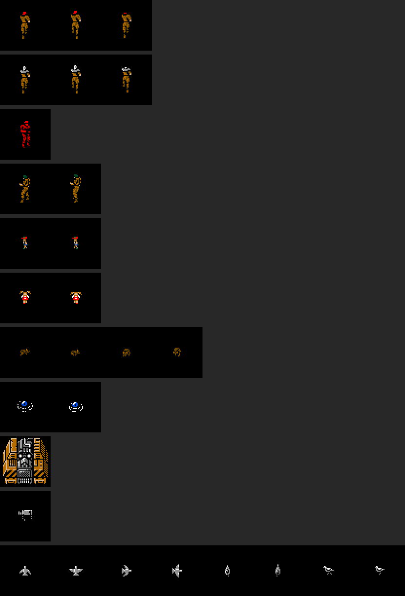

## One by one

<!-- generado:enemigos -->
### 1. Soldier in a red beret

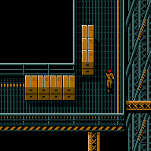

Zone 02, room 02, played; kinds 0x01, 0x06, 0x09, 0x0C; it is in 52 more rooms.

### 2. Soldier in a grey helmet

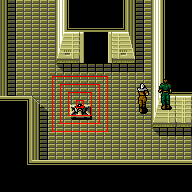

Zone 03, room 03, played; kinds 0x01, 0x04, 0x05; it is in 11 more rooms.

### 3. Soldiers in the red room

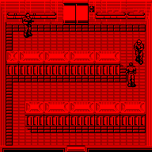

Special room 2E, room 00, played; kind 0x01; it is in one more room.

The usual soldiers, in a room whose palette is all reds.

### 4. Soldier in a green beret

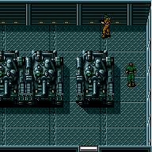

Zone 01, room 13, played; kind 0x02; it is in no other room.

BLACK COLOR tells Snake to tail a man in a green beret who is on 1F: «男のトクチョウはグリーンベレーをかぶっている。1Fにいるはずだ» (`p50:887B`). He is only in this room.

### 5. Child

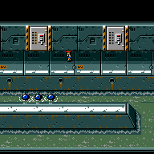

Zone 06, room 1D, played; kind 0x10; it is in 18 more rooms.

The children's messages are signed «こども» (`p50:82E3`). Punching them takes 4 life from Snake: the punch (`p03:A360`) goes through `delante_con_actores` (`p07:AED1`).

### 6. Girl with pigtails

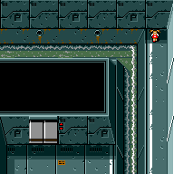

Zone 06, room 23, played; kind 0x11; it is in 9 more rooms.

A girl: here she says «ながれにさからってはいけないって、かた目のおじちゃんが。» (`p50:82E3`). As with the other children, punching her takes life from Snake.

### 7. Zanzibar hamster

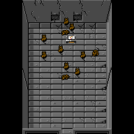

Special room 39, room 01, played; kind 0x12; it is in no other room.

Norden: «ザンジバーハムスター», said to be poisonous (`p49:A38E`).

### 8. Blue dome

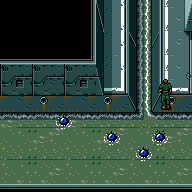

Zone 06, room 01, played; kind 0x13; it is in 7 more rooms.

### 9. Machine that runs along its route

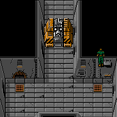

Zone 08, room 04, played; kind 0x14; it is in 3 more rooms.

### 10. Camera

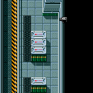

Zone 01, room 0A, played; kind 0x15; it is in 11 more rooms.

### 11. Pigeon

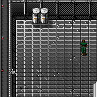

Zone 0F, room 03, played; kind 0x16; it is in no other room.

Norden: a wood pigeon trained as a carrier, «デンショばとにクンレンされたモリバト», probably brought by Marv (`p49:A024`).
<!-- /generado -->

## The ones in no room

Kinds 0x03, 0x08, 0x0B, 0x18 and 0x19 have their drawing table but are in no
room's list. Kind 0x0B is created by an event (`p12:6B0B`: at `0xD340`, with
Y = 0x20 and X = 0xA0); kind 8 is removed by `tipo_8_fuera` (`p12:6930`)
unless two game flags are set. The four of the alert (`0xD300`) arrive when an
enemy sees Snake; how many is counted by `cuantos_pueden_llegar` (`p14:B233`)
from Snake's level and the actors in the room. Those are not played here.
