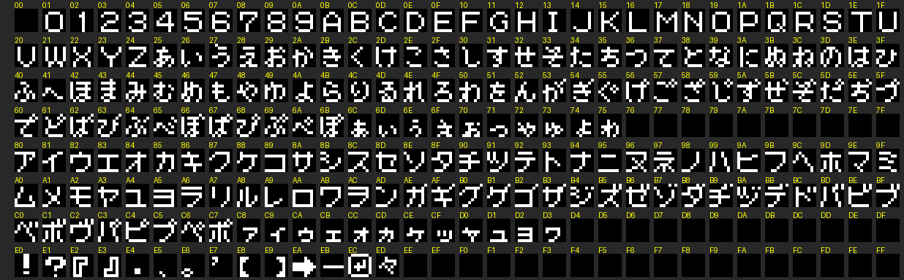
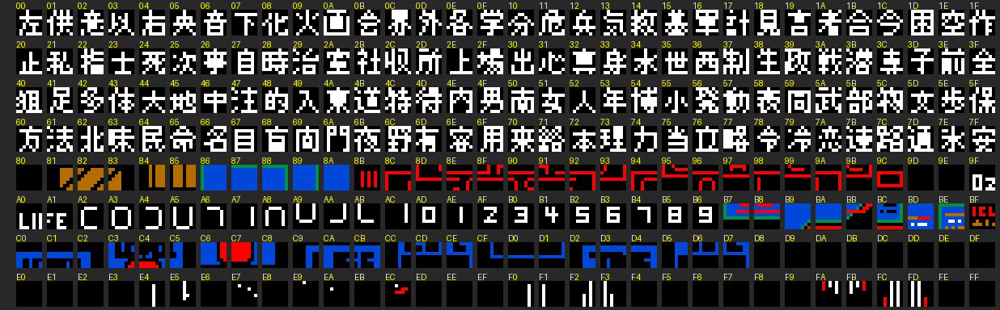

# The texts

## The font

The letters are drawn on **page 3 of the VRAM**, in 8 x 8 characters: letter
c is at ((c & 0x1F) x 8, (c >> 5) x 8) (`p00:4AEA`). There are two strips:
the top one with the figures, the letters, hiragana, katakana and the signs,
and the one with 0xF8 in front, with **128 kanji** and the pieces of the
status panel. Dumped after start-up and read character by character
(`tools/textos.py fuente`):





Of the 128 kanji, **114** appear in some text and **14 never** do: 火 面 国 制
多 特 表 武 歩 保 民 百 野 略.

## How they are written

The messages are in banks **48-49** (`0x8000-0xBFFF`) and **50-51**
(`bancos_del_mensaje`, `p01:666A`); one that ends a bank goes on in the
other. `siguiente_letra` (`p01:66C4`) writes them letter by letter:

| Byte | What it does |
|---|---|
| < 4 at the start | the speed (`p01:654F`) |
| 0xFF | the end |
| 0xFE | new line |
| 0xFD | waits for a key and goes on (▼) |
| 0xFC | waits, opens another window and, behind it, a new speed (▼▼, `p01:65E9`) |
| 0xFB | waits and ends (▽) |
| 0x76-0x7F, 0xD4-0xDF | who speaks: their name (`p50:8004`) and 『 |
| 0xF8 | the next letter is a kanji |

The **397 messages** in the listing come out like this, without a single
unknown letter. Those of the transceiver conversations are in
[The transceiver](THE-TRANSCEIVER.html); the rest, below.

## The signs

The short phrases painted all at once (`letrero`, `p00:4950`; those of
`p00:4918` carry the row and column of each line): what Snake picks up and
throws away, the names of the weapons and the equipment, those of whoever
speaks and the headers of F2 and F3. The descriptions of the weapons and the
equipment are in [Snake](SNAKE.html).

<!-- generado:letreros -->
| | |
|---|---|
| `p51:B1D9` | を、ニュウシュした。 |
| `p51:B1E4` | しかし、つかいみちが / ないのですてよう！ |
| `p51:B1F9` | サカナのホネ |
| `p51:B200` | ハトのフン |
| `p51:B206` | ヘビのヌケガラ |
| `p51:B20E` | マネキンのみぎうで |
| `p51:B218` | ネズミのしがい |
| `p51:B220` | バグチェックリスト |
| `p51:B22A` | タバコのすいがら |
| `p51:B233` | バナナのかわ |
| `p51:B23A` | コナミ　パラダイム |
| `p51:B244` | ドリンクのアキビン |
| `p51:B2C4` | ハンドガン |
| `p51:B2CA` | サブマシンガン |
| `p51:B2D2` | グレネード |
| `p51:B2D8` | タイクウミサイル |
| `p51:B2E1` | リモコンミサイル |
| `p51:B2EA` | プラスチック・バクダン |
| `p51:B2F6` | ジライ |
| `p51:B2FA` | カモフラージュ・マット |
| `p51:B306` | ムリョクカガス |
| `p51:B30E` | マウス |
| `p51:B312` | ライター |
| `p51:B317` | ワイヤー |
| `p51:B31C` | サイレンサー |
| `p51:B323` | タバコ |
| `p51:B327` | ソウガンキョウ |
| `p51:B32F` | ナイトビュア |
| `p51:B336` | ガスマスク |
| `p51:B33C` | ボデイ・アーマー |
| `p51:B345` | サンソボンベ |
| `p51:B34C` | ジライタンチキ |
| `p51:B354` | ハングライダー |
| `p51:B35C` | ダンボール |
| `p51:B362` | バケツ |
| `p51:B366` | カゼグスリ |
| `p51:B36C` | カセットテープ |
| `p51:B374` | タマゴ　？ |
| `p51:B37A` | ブローチ |
| `p51:B37F` | レッド　カード |
| `p51:B387` | ブルー　カード |
| `p51:B38F` | グレーン　カード |
| `p51:B398` | カード　1 |
| `p51:B39E` | カード　2 |
| `p51:B3A4` | カード　3 |
| `p51:B3AA` | カード　4 |
| `p51:B3B0` | カード　5 |
| `p51:B3B6` | カード　6 |
| `p51:B3BC` | カード　7 |
| `p51:B3C2` | カード　8 |
| `p51:B3C8` | カード　9 |
| `p51:B3CE` | スプレー |
| `p51:B3D3` | カートリッジ |
| `p51:B3DA` | B1　レーション |
| `p51:B3E3` | B2　レーション |
| `p51:B3EC` | B3　レーション |
| `p51:B3F5` | ダンヤク |
| `p51:B424` | SNAKE |
| `p51:B42A` | キャンベル |
| `p51:B430` | ホーリー |
| `p51:B435` | マスター |
| `p51:B43A` | ノルデン |
| `p51:B43F` | ケスラー |
| `p51:B444` | ナターシャ |
| `p51:B44A` | マルフ |
| `p51:B44E` | ペトロ |
| `p51:B452` | FOX |
| `p51:B456` | BOSS |
| `p51:B45B` | BLACK |
| `p51:B461` | COP |
| `p51:B465` | ランニング |
| `p51:B46B` | RED |
| `p51:B46F` | BOX |
| `p51:B473` | プレデター |
| `p51:B479` | パイロット |
| `p51:B47F` | こども |
| `p51:B483` | へいし |
| `p51:B4AD` | WEAPON　SELECT / OPTION |
| `p51:B4C6` | EQUIPMENT　SELECT |
<!-- /generado -->

## The rest of the messages

The scenes, the warnings and what is said outside the transceiver, in ROM
order.

<!-- generado:textos -->
`p48:8018`

```
SNAKE『こちらSOLID　SNAKE。
オウトウねがいます・・・
```

`p48:9534`

```
マスター『タバコでカザムキきがわかるぞ。
うまくつかえ・・・OVER ▽
```

`p48:9833`

```
キャンベル『サーチライトは動きをよみとり、タ
イミングをはかってモノカゲからモ
ノカゲへすばやくイドウしろ
・・・OVER ▽
```

`p48:9D50`

```
キャンベル『おじちゃん、スネークさん？・・
わたし、キャリー。
パパはつりにいっちゃったの。 ▼
大ジョウブ・・・ムセンキ、もっ
ていったから。
シュウハスウは140・99・・
こんどあそびにきてね。バーイ ▽
```

`p49:A1B5`

```
・・・OVER ▽
```

`p49:A1BD`

```
・・・OVER ▽
```

`p49:A1C5`

```
・・・OVER ▽
```

`p49:ACC0`

```
・・・OVER ▽
```

`p49:BB4C`

```
ホーリー『SNAKE！大へんっ！！ ▽
```

`p50:8227`

```
こども『スイコウの水はつめたいからながく
入っているとカゼひくよ
```

`p50:8247`

```
こども『おにいちゃん、あのブロンドのおね
ぇちゃんとトモダチ？
```

`p50:8264`

```
こども『このスイコウはジェット水リュウで
むこうのビルとつながってるんだっ
て
```

`p50:828A`

```
こども『かた目のおじちゃんにミドリのフク
の人がきたらつたえてくれって。 ▼
おねえちゃんはここにはいない
って
```

`p50:82C0`

```
こども『スイコウの下にね・・・
ふるい地下水道があるんだってさ
```

`p50:82E3`

```
こども『ながれにさからってはいけない
って、かた目のおじちゃんが。 ▼
ながれに身をまかせると見えなか
ったものが見えてくるって・・・
なんのことかわかる？
```

`p50:8331`

```
なんのことかわかる？
```

`p50:833C`

```
なんのことかわかる？
```

`p50:8347`

```
こども『ここから、西北のところに動物のシ
イク所があるの
```

`p50:8366`

```
こども『ここはね、夜になるとジカハツデン
なんだ。だからデンリョクのいるレ
ーザーフェンスはきえるんだ。 ▼
そうなったらボクらも中であそべる
んだ。見つかるとおこられるけど
```

`p50:83BC`

```
こども『かた目のおじちゃんはボクらのおや
がわりさ。おじちゃんは大人がきら
いなんだ
```

`p50:83E7`

```
こども『夜、ふくろうがなくから・・・
こわくてねむれないの
```

`p50:8403`

```
こども『そこのベランダはパラシュートこう
か用につくられたんだよ。 ▼
でもハングライダーだったら・・・
もっととおくへいけるだろうなぁ
```

`p50:8444`

```
こども『この前までこの南にベランダがあっ
たんだけど通路がうめられたんだ
```

`p50:846A`

```
こども『この南にミドリのパイナップルみ
たいなものがいっぱいあったんだけ
ど
```

`p50:848F`

```
こども『ギブ・ミー・キョコレート！
にいちゃん、B1レーションもって
ない？ ▼
B1レーションにチョコレートがは
いってるんだ
```

`p50:84CB`

```
いってるんだ
```

`p50:84D2`

```
こども『収容所の中はネズミがおおいんだ。
ネズミはスになんでももちこんじゃ
うんだ。 ▼
だからネズミよけにノウリュウサン
をおいてあるんだってさ
```

`p50:851B`

```
こども『ここはそこなしぬまだからちかづく
と危ないんだって。
けど・・ボクたしかに見たんだ。 ▼
大きなトラックがこの上を通ってい
くのを。しんじてくれる？
```

`p50:856A`

```
こども『ここからよくトラックがではいりし
てるよ
```

`p50:8580`

```
こども『タイクウミサイル、スティンガー
だろっ？ ▼
この前、戦シャにソウビするとかな
んかで、ザンジバービルの1Fの西
ガワのコウジョウにもってったよ
```

`p50:85CB`

```
こども『わたし、ジュウをもった人、
大きらい！！
```

`p50:85E4`

```
こども『ヒミツをおしえてあげる？ ▼
ナターシャねぇちゃんのね。
ブローチね・・サウナやレイトウコ
に入るとかたちがかわるのよ
```

`p50:8620`

```
こども『あっ、みつかっちゃった！
・・・かくれんぼしてたの
```

`p50:863C`

```
こども『ナターシャねえちゃんのロッカーは
いちばん右上よ。サウナから上がっ
てきた時によく見たわ
```

`p50:866F`

```
こども『ここにはトイレがひとつしかないの
。このかいの南東にあるんだけど
・・・夜、こわくて
```

`p50:869E`

```
こども『このオクにマネキンの兵タイさんが
いっぱいあるよ。
```

`p50:86BA`

```
こども『ここの大人たちはコッカがかかると
キリツしてしまうんだ。
それがきまりなんだって
```

`p50:86E6`

```
こども『カゼをひいた時はイム室にいってク
スリをもらえばいいんだ
```

`p50:8706`

```
こども『夜でも見えるソウガンキョウってし
ってる？
```

`p50:871F`

```
SNAKE『ん？・・・
ハトの足にカミがしばってあるぞ ▼
HELP！　WIS、0HI0
KIO　MARV・・・ ▼
Hだけが小文じ？
マルフ博士のでん言なのか？
なんの意味だろうか？
```

`p50:87AC`

```
マルフ『ふふ・・・おろかな、
FOX　HOUNDER！ ▼▼

マルフ『マルフ博士はここにはいないっ！
こんな安っぽいハッシンキでだまそ
うとはFOX　HOUNDもソウト
ウ、ジダイおくれだな ▽
```

`p50:8807`

```
BLACK『オレはBLACK　COLOR
NASAのタイチキュウ外カンキョ
ウトクシュブタイ出身。 ▼
世界ーのハイテクフセイキ戦ブタイ
、FOX　HOUNDとやらのジツ
リョクを見せてもらおうか！ ▼
こいっ！FOX　HOUNDER ▽
```

`p50:887B`

```
BLACK『・・・SNAKE ▼▼

SNAKE『だれだ？・・なぜ、名前を ▼▼

BLACK『オ、オレだ・・・シュナイダー。
カイル・シュナイダーだ。
おぼえているか？ ▼▼

SNAKE『シュナイダー？
・・・あのOUTER　HEAVE
Nのレジスタンスだった？ ▼
しかし、あの時・・・ヤツらにころ
されたはず ▼▼

BLACK『SNAKE、
お前もまだあまいな。 ▼
オレがころされかけたのはヤツら
にではない、お前らとお前らの
クニにだ ▼▼

SNAKE『シュナイダー？イミがわからん ▼▼

BLACK『・・・SNAKE、お前がメタル・
ギアをハカイしたあと、 ▼
NATO軍による大キボなOUTE
R　HEAVENバクゲキがおこな
われた。 ▼
レジスタンスであったわれわれも
OUTER　HEAVENの女コド
モも・・・みんな見すてられた。 ▼
カレらはモウカの中でにげまとい
・・・のたれ死んでいった ▼▼

SNAKE『そんな、ばかな・・・ ▼▼

BLACK『もともとOUTER　HEAVEN
のコドモたちは世界カッコクからあ
つめられた戦ソウコジやナンミンだ
。 ▼
ヤツらにとってカレらのようなコド
モたちはふれたくはないソンザイだ
った・・・ ▼▼

SNAKE『・・・まさか ▼▼

BLACK『お前らも同じだ。
いずれわすれられる・・・
しかし、あの人は・・・ ▼▼

SNAKE『あ・の・人・・・？ ▼▼

BLACK『にげまとうわれわれを救ってくれた
のは・・・あのお方。 ▼
あの人はわれわれのしたことをゆる
してくれた上、われわれにあたらし
いトチやカゾクをあたえてくれた
・・・ ▼▼

SNAKE『あの人・・・もしや？ ▼▼

BLACK『SNAKE、今にお前もわかる。
あの人のすばらしさが・・・ ▼▼

BLACK『SNAKE・・・お前にはかりはあ
ってこそうらみはない。
博士の場所をおしえてやろう。 ▼
あの人のイシにさからうことではな
い・・・博士のカンキンされている
ドクボウのみはりをさがすんだ。 ▼
その男をビコウすれば・・・ドクボ
ウへたどりつける。 ▼
男のトクチョウはグリーンベレーを
かぶっている。1Fにいるはずだ。
いいか・・グリーンベレーだ。 ▼
グリーンベレーの男をビコウしろ！
 ▽
```

`p50:8BDA`

```
ランニング『ひさしぶりのキャクジンか？
・・・いいところに来たぜ。 ▼
これからひとっぱしりしようとおも
っていたところだ。 ▼
オレはRUNNING　MAN
世界ーシュン足なヨウヘイだ。
オレの足についてこれるかな？ ▼▼

ランニング『見てろっ！！
```

`p50:8C4E`

```
ランニング『・・・ハァ・・ハァ・・・どうだ？
はやいだろう？
そろそろホンバンといこうかっ！
```

`p50:8C79`

```
ランニング『きこえるか・・・この音。
シンケイガスだ。
ガスにおかされる前におれを
たおせばお前はたすかる ▼
時間のショウブだ・・いくぞっ！
```

`p50:8CBF`

```
ランニング『・・オレの・・オレのはやさをサカ
テにとるとは？
お前の名は？ ▼▼

SNAKE『SNAKE・・・
SOLID　SNAKE ▼▼

ランニング『・・・SNAKE？
チータがヘビにまけた・・
なぜ？ ▼▼

SNAKE『・・・死にいそいだんだろう？
```

`p50:8D27`

```
SNAKE『こ、これは？
・・・ブービー・トラップ？ ▼▼

RED『その通りだ。
キツネを生けどるトラップさ。
FOX　HOUNDER！
```

`p50:8D64`

```
RED『おれはRED　BLASTER
これで動けまい。おれのグレネード
でゆっくりリョウリしてやろう
```

`p50:8D95`

```
プレデター『まってたぞ。SNAKE！
おれはPREDATOR。
ジャングル内でのアンブッシュでは
おれの右にでるものはいない。 ▼
本物のヘビかどうかためしてやる
```

`p50:8DE4`

```
BOX『おれたちはみっ室専門のアンサ
ツブタイULTRABOX
だ。 ▼
大トウリョウおかかえのゴクヒ
チームだ。 ▼
おれたちにリョウリされること
をホコリにおもえ
```

`p50:8E35`

```
ペトロ『あっ！・・・SNAKE。
ておくれじゃ・・・たった今、イキ
をひきとったよ。 ▼
シンゾウがもたんかったんじゃ
```

`p50:8E6D`

```
SNAKE『ん？クビスジにアザが？ ▼▼

ペトロ『シンパイせんでもいい、SNAKE
マルフが死んでもOILIXの
セッケイズは大ジョウブじゃ。 ▼
マルフは用心ぶかい男、マンイチ
の時のためにセッケイズをのこしと
る。 ▼
ヤツはゲーム・マニアとしても有名
じゃった。
西がわからマイツキ、コジンユニュ
ウしとったホドじゃ。 ▼
ヤツはスウジツ前、ゲームのカート
リッジのキバンにマイクロフィルム
をかくしたらしい。 ▼
コナミというニホンのゲームメーカ
ーのMSXカートリッジらしい ▼▼

SNAKE『MSXといえば世界ーのハードすう
をほこるパソコン・ハードじゃない
か ▼▼

ペトロ『そのカートリッジをそこのロッカー
にしまったらしいのじゃ ▼▼

SNAKE『カギは？ ▼▼

ペトロ『ない・・・ロをわらなかった。
いや・・・なにもきいておらん！
```

`p50:8FC4`

```
ペトロ『そんなところかのう。SNAKE ▼▼

ペトロ『わしは・・・きみらの世界にわしの
すべてをかけていたんじゃ。
そのためにすみなれたクニをすて ▼
じゃがきみらはわしをバトウし、こ
とごとくヒナンした。 ▼
わしは・・・METAL　GEAR
をカンセイさせたかったのじゃ！ ▼
わしのロボットロジーのすべてをこ
いつに。 ▼
じゃがきみらの政治かたちはSDI
やNEDW、ブレインボムなんぞに
しかキョウミをしめさなかった！ ▼
わしは東西のカガクジョウホウをな
がしながら・・・ ▼
METAL　GEARのカイリョウ
をつづけた。ザンジバーランドのエ
ンジョをうけながら ▼▼

SNAKE『ペトロビッチ。
お前がマルフ博士を？ ▼▼

ペトロ『そうじゃ。どうしてもOILIXの
セッケイズをわたそうとせんからじ
ゃ！ ▼
ナターシャがハシで死んだのも・・
わしが地下水道でFOXに連絡した
からじゃ ▼▼

SNAKE『あの時のトイレ！・・・ ▼▼

ペトロ『SNAKE。マルフから、いやナタ
ーシャからあずかったマルフのロッ
カーのカギをわたせ！！
```

`p50:9182`

```
ペトロ『ス、スネーク・・・・ ▼▼

ペトロ『SNAKE・・ヤツがこのままお前
を見のがすはずはない。 ▼
あれを・・METALをつかうはず
じゃ。 ▼
ム、ムスメのエレンへの・・・
プレゼントじゃ。 ▼
あれのハカイ方法を・・おしえてや
る ▼▼

SNAKE『シンガタMETAL　GEARのハ
カイ方法だな？ ▼▼

ペトロ『わしは心の中の東西のカベをこえる
ことはできんかった・・・ ▼
じゃが、ムスメはちがう。
東がわにのこしてきたエレンのため
に・・・SNAKE ▼▼

SNAKE『METAL　GEARのハカイ方法
は？ ▼▼

ペトロ『ソウコウのうすいキャクブにグレネ
ードを・・・
これ以外の方法ではハカイできん。
足に・・・グレネードを。 ▽
```

`p50:92AE`

```
『こっちだ、SNAKE！ ▽
```

`p50:92BB`

```
SNAKE『BIG　BOSS・・・生きていたのか ▼▼

BOSS『SNAKE・・・
ようこそザンジバーランドへ・・・
やはりもどってきたな。わたしのもとへ ▽
```

`p50:92FF`

```
SNAKE『オレは3年間とりついているアクムをはらいに
きた。 ▼▼

BOSS『アクム？はらえやせんよ。　SNAKE、
・・・いちど、戦トウのカイカン、テンション
を味わったものはー生・・・戦場に身をおくこ
とになる。 ▼▼

BOSS『いちど、ヒョウシュツした戦トウホンノウは2
ドとねむることはないのだ。よりキョウレツな
テンションがほしくなる。 ▼
このどうしようもないカンカク・・・ヨウヘイ
であるお前ならよくわかるはず。 ▼
おまえたちのヨッキュウをユイイツ、みたして
くれるものはケンリョクでもカネでも、SEX
でもない。
ただひとつ・・・WAR［戦ソウ］だ！ ▼
わたしはお前らにその場をあたえているのだよ
お前らの生きがいをな。 ▼▼

SNAKE『ギゼン者きどりか？　BIG　BOSS ▼▼

BOSS『お前もあのこどもたちを見ただろう？
世界カッコクで生まれた戦ソウギセイ者。
そして次の戦ソウをになう戦士のたまごたち ▼
戦ソウをユウハツさせ、シエンし、ギセイ者を
生み・・・キュウゴ、クンレンして・・・ふた
たび戦場にフィードバックさせる。 ▼
じつに合理的なシステムだ。この世にあらそい
はたえることはない。　われわれのモクヒョウ
・・・生きがいも。 ▼▼

SNAKE『ショクにあぶれることはない・・とでもいいた
いのか！ ▼▼

BOSS『わたしもお前も、戦場でこそキショウカチだが
クニへかえればブキヨウなデクだ。 ▼
われわれのキゲンをとりにくるのは、せいぜい
安っぽいシュウカンシのジャーナリストくらい
だろうて。 ▼
お前もわたしも戦場で、のたれ死ぬまでここに
のこるしかないのだ。 ▼▼

SNAKE『・・・オレの戦いは、ただひとつ。キサマから
ジユウになるために、アクムをはらうために、
・・・BIG　BOSS、キサマをたおす！ ▼▼

BOSS『どちらがかってもわれわれのたたかいはおわら
ない。　ハイ者は戦場からカイホウされるが、
ショウ者は戦場にのこる。 ▼
そして、生きのこった者は死ぬまで戦士として
人生をまっとうするのだ。 ▼▼

SNAKE『レイガイもある。
オレは・・人生をあいしている。 ▼▼

BOSS『SNAKE、わかった。
わたしがキサマをクノウからカイホウしてやろ
う。もとジョウカンのよしみだ
・・・らくにしてやる。 ▼▼

SNAKE『もうあんたのせわにはならん！ ▼▼

BOSS『ほう？・・・その体で、ブキもなしに・・・
このわたしに？
ショウサンがあるというのか！？ ▼▼

SNAKE『さいごまでけっしてあきらめない。　いかなる
キュウチでもセイコウをイメージする。
・・・あんたのことばだ。 ▼▼

BOSS『わたしも時にはあやまりをおかす。 ▼
SNAKEっ！
・・・こんどこそさいごのたたかいだ。
イッカイきりの・・・こいっ！！ ▽
```

`p50:9770`

```
BOSS『SNAKE！！
```

`p50:977A`

```
BOSS『まだだ・・・まだまだ・・・
```

`p50:978A`

```
BOSS『SNAKE・・・まだだ・・
```

`p50:979A`

```
FOX『SNAKE！このMETAL　GE
ARにハカイ方法なぞないわ。
おいぼれ学者のひとりよがりだ！ ▼▼

SNAKE『FOXか？・・・どこにいる？ ▼▼

FOX『すぐ会えるさ、SNAKE。
ショウメンのドアを通ってこい！
```

`p50:9802`

```
FOX『SNAKE！
オレも・・このMETAL　GEA
Rもムカシとはちがう。 ▼
本物のキョウフとハイボクカンを味
あわせてやる！
```

`p50:9844`

```
SNAKE『ここは？ ▼▼

FOX『ケッチャクをつけるにはサイコウの
リングじゃないか
```

`p50:9866`

```
FOX『SNAKE。ひさしぶりだな・・・
このジライゲンの中で・・・スデで
どうだ？ ▼▼

SNAKE『チキン・ファイトか ▼▼

FOX『FOX　HOUNDサイコウのライ
バル。オレはおまえとやれる時を心
まちにしていた！ ▼▼

SNAKE『FOX！キサマのくさりきったショ
ウネをたたききなおしてやるっ！ ▼▼

FOX『SNAKE！
FOXのショウゴウのとうとさをお
もいしれ！ ▽
```

`p50:990C`

```
FOX『SNAKE・・・
どうやらFOXのショウゴウをゆずる時がきた
らしいな ▼▼

SNAKE『FOX・・・なぜだ？ ▼▼

FOX『オレは・・お前とちがって、フクザツな立場に
ある。 ▼
BIG　BOSSはお前にとってはたんなるジ
ョウカンにすぎなかつたかもしれんが。
オレはカレに2ド、命を救われた。
ブタイに入るずっと以前のことだ。 ▼
オレはベトナムでの2世だった・・・
当時、ハク人との2世はシュウ戦ゴもハクガイ
されキョウセイロウドウをしいられていたの
だ。 ▼
あの人はあのジゴクからオレを救ってくれた。
ここの子供たちのように・・・ ▼
2ド目はモザンビーク。
レモナ兵としてゴウモンされていたところをた
すけられた。その時、オレはみみもはなもそが
れ・・・ひどいジョウタイだった ▼▼

SNAKE『オンガエシのつもりか！！これが・・・ ▼▼

FOX『そうではない。オレは戦ソウがにくい。
ここのこどもたちのように。
だが・・・オレには戦ソウがヒツヨウだ。 ▼
オレたちのような戦ソウやはイッパン社会では
生きてはいけない。オレたち、戦ソウやには戦
場がヒツヨウなんだ。 ▼
BOSSはオレたちにたたかう場をあたえてく
れる。もって生まれたトウソウホンノウをごま
かすことはできない。 ▼
・・・オレは戦場で生まれて・・戦場で死ぬ。
SNAKE・・・オレたちはたたかうしか・・
たたかうしかない。人を・・まして、女をしあ
わせにすることなんぞ・・・できやしねぇ ▼▼

SNAKE『カノジョのことか・・・ ▼▼

FOX『オレにはダイイング・イン・アクションがに合
いだ ▼▼

SNAKE『FOX、安心しろ。オレはけっしてお前のよう
にはならん ▼▼

FOX『そのことば・・・あの世へみやげにもっていく
・・・うまくやれよ、SNAKE。
・・・ファンのキタイをうらぎるなよ ▼▼

SNAKE『ファンのキタイ？！・・そうか！
FOXだったのか・・あのムセンは ▼▼

FOX『オレのわがままのダイショウさ・・・
さきにいくぜ。SNAKE ▼▼

SNAKE『ひとりじゃないぜ、フランク。
むこうでナターシャがまっている ▼▼

FOX『・・・ナターシャ・・・ ▼▼

FOX『・・・ありがとう・・・SNAKE ▽
```

`p50:9C93`

```
FOX『SNAKE！
カートリッジはもらっていくぞ、
・・・やけ死ぬがいい！
```

`p50:9CB9`

```
SNAKE『し、しまった！！
・・・タマがきれたっ！
```

`p50:9CCF`

```
ホーリー『SNAKE？！
```

`p50:9CD9`

```
ホーリー『ヘリだわっ・・たすかったのよ！
```

`p50:9CEB`

```
SNAKE『クリスマスに間に合うかな？
```

`p50:9CFD`

```
ホーリー『まだユウショクには間に合うわ。
SNAKE
```

`p50:9D17`

```
SNAKE『いこうか・・・
キリストはにげないさ
```

`p50:9D2C`

```
キャンベル『ごくろうだったな、SNAKE・・・
どうだ？
もういちど・・ブタイへもどらないか？
```

`p50:9D57`

```
SNAKE『・・・アクムははれた。オレはジユウだ
```

`p50:9D6C`

```
キャンベル『そうか・・・ザンネンだ。
ところであのカートリッジだが・・・本当にマ
ルフ博士ののこしたものなのか？？
```

`p50:9DA5`

```
ホーリー『カートリッジをあけてみたら？
```

`p50:9DB5`

```
SNAKE『そのヒツヨウはない。オレがもちかえったのは
まちがいなくマルフ博士ののこしたカートリッ
ジだ。
そのままMSXにさしこんでみろ
```

`p50:9DF8`

```
キャンベル『わかった・・・よしっ
```

`p50:9E04`

```
ホーリー『・・・なに？・・・なにもかわらないわ
```

`p50:9E19`

```
キャンベル『こ、これは・・・
そうか、SNAKEの言う通りだっ！
これはまぎれもなくマルフ博士ののこしたカー
トリッジ
```

`p50:9E54`

```
ホーリー『なんの事？・・わたしにはなにも見えないわ
```

`p50:9E6C`

```
SNAKE『ほらっ、よく見るんだ・・・マルフ博士のサイ
ンがしるされている・・・
ここ、KIO　MARVのフルネームが
```

`p50:9EA6`

```
ホーリー『あっ、ほんと・・さかさまになっているのね
```

`p50:9EBC`

```
キャンベル『これで世界は救われる・・・
```

`p50:9ECE`

```
SNAKE『マルフ博士のさいごのパフォーマンス
```

`p50:9EE4`

```
ホーリー『カレは心からゲームをあいしていたのよ・・・
きっと
```

`p50:9F00`

```
キャンベル『マルフ博士はバカげた政治ゲームにまきこ
まれて死んだ
```

`p50:9F21`

```
ホーリー『でも・・・カレののこしたゲームはみんなを救
ったわ。ね、SNAKE？
```

`p50:9F46`

```
ホーリー『SNAKE？・・・どこいったの？
ねぇ、SNAKEがいないわ！
```

`p50:9F68`

```
キャンベル『・・・SNAKE？・・・にげられたか？
```

`p50:9F7D`

```
ホーリー『SNAKE！SNAKE！
・・・ユウショクのヤクソクをしてたのにひど
いわ・・・・
```

`p50:9FA9`

```
SNAKE『ハシだっ！！ ▽
```

`p50:9FB2`

```
ナターシャ『ー人ずつしかわたれないわ ▽
```

`p50:9FC2`

```
ペトロ『わしからいこう。オイサキみじかい
もの、どうなってもダレもかなしま
んわい ▽
```

`p50:9FEA`

```
ペトロ『大ジョウブじゃ！わたってこい ▽
```

`p50:9FFC`

```
ナターシャ『じゃ、次はわたしね・・・
おさきに、SNAKE ▽
```

`p51:A017`

```
ナターシャ『大ジョウブみたいよ。SNAKE、
はやくわたってきて！ ▽
```

`p51:A036`

```
SNAKE『ナターシャっ！！ ▽
```

`p51:A041`

```
SNAKE『・・・ナ、ナターシャ ▽
```

`p51:A04E`

```
ナターシャ『・・・あ、わたし ▽
```

`p51:A059`

```
ナターシャ『わたし、やっぱり・・・
氷の上しかあるけなかったみたい。 ▼
すべることばかりで・・・
リョウアシで、ちゃんとリョウアシでジメンを
ふみしめてあるくことをしなかったわ・・・
 ▽
```

`p51:A0B3`

```
SNAKE『東西の氷はとけはじめているんだ。
ナターシャ？
こんどこそジメンの上をしっかりと・・
自分の人生の上をふみしめて味わう時だ。 ▼
ナターシャ？
まだだ、まだだ・・・ ▽
```

`p51:A111`

```
ナターシャ『もういいのよ・・・わたし、なん人もの死を見
てきているわ。
自分がどんなジョウタイか・・・わかる。 ▼
・・・ザンネンだわ。
またいい人にめぐりあえたのに ▽
```

`p51:A165`

```
SNAKE『キミのスケートをもういちど、見たかった ▽
```

`p51:A17C`

```
ナターシャ『あ、ありがとう・・・
これ・・ドアをあけるカード6よ。それから
・・・ブローチ、つかい方は・・・ ▽
```

`p51:A1B0`

```
SNAKE『つかい方は？ ▽
```

`p51:A1BA`

```
ナターシャ『・・・あ、もうだめ ▽
```

`p51:A1C6`

```
ナターシャ『・・・フランク・・・
```

`p51:A1D3`

```
ペトロ『SNAKE！！ ▽
```

`p51:A1DD`

```
SNAKE『・・・・メタル・・ギア？ ▽
```

`p51:A1EC`

```
FOX『SNAKEっ！！オレだ。
・・・・GREY　FOXだ！ ▽
```

`p51:A20A`

```
SNAKE『GREY・・　FOX・・・・ ▽
```

`p51:A21B`

```
FOX『きさまにこのハシはわたらせん！！
ペトロビッチは連れていく。 ▼
どうだ、SNAKE？ムカシのよしみだ。
ここは見のがしてやってもいい。
さっさとここから立ちされっ！
いいか・・いますぐに・・くにへかえれ！ ▼
わかったな・・・ハハハァ・・・ ▽
```

`p51:A295`

```
SNAKE『FOX！・・・・オレはあきらめんぞっ！ ▽
```

`p51:A2AB`

```
ペトロ『おーい！SNAKE
・・・もうだめじゃ！
すこしやすませてくれ ▽
```

`p51:A2CD`

```
ナターシャ『SNAKE・・・？ ▽
```

`p51:A2D9`

```
SNAKE『わかった・・・
すこしキュウケイしようか ▽
```

`p51:A2F0`

```
ペトロ『わしは・・・
ちょっと用を足してくる ▽
```

`p51:A307`

```
ナターシャ『・・・おかしいわね ▽
```

`p51:A313`

```
SNAKE『シカタない、
ペトロヴィッチはああ見えても年だ ▽
```

`p51:A32F`

```
ナターシャ『ちがうわよ。わたしたち・・・
世界的なテンサイ学者、もとオリンピックセ
ンシュ、もとトクシュブタイタイインがこん
な下水道で・・・ ▽
```

`p51:A37B`

```
SNAKE『・・・ウンメイさ ▽
```

`p51:A386`

```
ナターシャ『ウンメイ？そうね、そうかもしれないわ・・・
わたしね、コドモのころ・・
よくきかされたの。 ▼
わたしのハハに・・・だい2次世界大戦中のポ
ーランド、ワルシャワほうきのハナシ。
わたしのハハは地下水道をナンニチもはしって
ナチスのてからにげのびたの。 ▼
ドロまみれになって・・真っクロになって・・
カオも見わけがつかないくらいにね。
・・・オヤコね。わたしもハハも・・・
戦そうにとりつかれているのよ。きっと ▽
```

`p51:A45F`

```
SNAKE『・・・ナターシャ。スケートをやめてどうして
STBなんかに？
いくら東がわでもオリンピックセンシュともな
るとタイグウがいいんじゃないのか ▽
```

`p51:A4A8`

```
ナターシャ『・・・そうでもないわ。
なんていうか・・・そう、氷が・・氷が冷たく
かんじたから ▽
```

`p51:A4D6`

```
SNAKE『氷・・・？ ▽
```

`p51:A4DF`

```
ナターシャ『SNAKE、おくさんはいるの？ ▽
```

`p51:A4F1`

```
SNAKE『・・・いや、カゾクはいない。キミは？ ▽
```

`p51:A506`

```
ナターシャ『ひとりよ・・・べつにドクシンシュギシャ
でもないわ。チャンスがなかったのかしら ▽
```

`p51:A530`

```
SNAKE『恋人は？ ▽
```

`p51:A539`

```
ナターシャ『・・・いちどだけ、
いちどだけケッコンをかんがえたことがあった
。わたしがまだ氷の上をはしっていたころ。 ▼
今でもくるしくなるような大恋あいだった・・
フランク・ハンターっていう西がわの男。
ハンサムでシンシで・・・インテリで。
でもいつもなにかにおびえていた。 ▼
わたし、カゾクもスケートもなにもかもすてて
・・・どこまでもおいかけていきたかった ▽
```

`p51:A5EF`

```
SNAKE『ボウメイを？ ▽
```

`p51:A5F8`

```
ナターシャ『そう・・・でもだめだった。
西がわはわたしのうけ入れをサイゴになって
キョヒしたの。
よくわからないけど、政治的なリユウで・・ ▽
```

`p51:A63F`

```
SNAKE『レセプション・コミュニティーがととのってい
なかったんだ。よくあることだ ▽
```

`p51:A666`

```
ナターシャ『それ以来、わたしやカゾクはひどいセイカツを
・・・わたしたちはセンシュケンをうばわれ、
リフューズニクにされ・・・
STBに入るしかなかったのよ。 ▼
でも、コウカイはしてないわ。
以前の氷の上しかしらなかったわたしとちがっ
て今ではいろんな事をしったわ。
・・・人もころした ▽
```

`p51:A6FB`

```
SNAKE『カレには・・・それ以来？ ▽
```

`p51:A70C`

```
ナターシャ『会ってないわ。・・・わたしたちの中のベルリ
ンのカべはいつまでものこっていたのね。 ▽
```

`p51:A73A`

```
ペトロ『おーい！！おまたせ ▽
```

`p51:A746`

```
SNAKE『・・・ながいトイレだ ▽
```

`p51:A753`

```
ナターシャ『・・・いきましょう。SNAKE ▽
```

`p51:A765`

```
ペトロ『おう！・・・ナターシャ、
SNAKE！ ▽
```

`p51:A77B`

```
ナターシャ『よくゴブジで・・・ ▽
```

`p51:A787`

```
SNAKE『・・・すこしやせたな
・・・ペトロヴィッチ ▽
```

`p51:A79F`

```
ペトロ『きみはかわらんな、SNAKE ▽
```

`p51:A7B0`

```
ナターシャ『SNAKE、いそぎましょう！
マルフ博士のところへ ▽
```

`p51:A7CE`

```
ペトロ『なにっ、マルフはブジか。 ▼
わしもここからなんとかダッシュツ
しようとしたんじゃがこのエレベー
ターは内がわからひらかんのじゃ ▽
```

`p51:A810`

```
SNAKE『ナターシャ、3人でいちれつになっ
てすすもう！ ▽
```

`p51:A82B`

```
ペトロ『まってくれ！SNAKE、
あんたにわたすもんがある ▽
```

`p51:A847`

```
ペトロ『ミハリからくすねておいたんじゃ
・・・カード5 ▽
```

`p51:A861`

```
ナターシャ『あなたのあとについていくわ、
SNAKE ▽
```

`p51:A878`

```
SNAKE『ナターシャ？ ▽
```

`p51:A881`

```
ナターシャ『・・・そうよ、私・・・
STBキョクインのナターシャ・マルコヴァ ▽
```

`p51:A8A5`

```
ナターシャ『SOLID　SNAKEね・・・
おたがいおうものは同じ。キョウリョクして
マルフ博士をたすけましょう ▽
```

`p51:A8DD`

```
SNAKE『・・・どこかであったことがある？ ▽
```

`p51:A8F0`

```
ナターシャ『それっ？西がわの男たちのダイヒョウ的な
くどきモンクでしょ ▽
```

`p51:A913`

```
SNAKE『そうだっ！・・・おもいだしたぞ。
ナターシャ・マルコヴァ、氷のヨウセイ・・・
カルガリー・オリンピックのゴールドメダリス
ト ▽
```

`p51:A955`

```
ナターシャ『・・・人ちがいだわ ▽
```

`p51:A962`

```
SNAKE『そんなはずはない。たしかに・・・ ▽
```

`p51:A975`

```
ナターシャ『そんなことより、マルフ博士は？ ▽
```

`p51:A989`

```
SNAKE『ムセンキでコンタクトしたんだが・・・
コトバが通じない ▽
```

`p51:A9A8`

```
ナターシャ『ブジなのね・・・よかった。
コガタムセンキのうめこみシュジュツをして
おいてよかったわ。
SNAKE、ムセンキかして・・・ ▽
```

`p51:A9E8`

```
SNAKE『シュウハスウは140・51だ ▽
```

`p51:A9F9`

```
ナターシャ『SNAKE、今のところマルフはブジよ。
タワービルの北に大きなクレバスがあるんだけ
ど・・・そのさきの収容所にいるらしいわ。 ▼
マルフ博士はペトロヴィッチ博士のことを
シンパイしていたわ ▽
```

`p51:AA62`

```
SNAKE『ペトロヴィッチはブジだ。シンパイない。
さきにマルフを救出する。・・・いいな ▽
```

`p51:AA8D`

```
ナターシャ『クレバスへならチカミチがあるわ。
この下にふるい地下水道があるの。
そのエレベーターでおりれるわ・・・
いきましょう ▽
```

`p51:AACF`

```
SNAKE『ヒューッ！こんなところに・・・
エレベーターが ▽
```

`p51:AAE9`

```
ホーリー『・・・ごめん。
大ジョウブ・・・わ・た・し ▽
```

`p51:AB02`

```
SNAKE『ホーリー！？ ▽
```

`p51:AB0B`

```
ホーリー『おどろいた？ ▽
```

`p51:AB14`

```
SNAKE『フウーッ・・・命びろいした。
で、どうした？・・・こんなところまで？ ▽
```

`p51:AB3A`

```
ホーリー『ヤクソクしたでしょ？
生きていたらいつでも会える ▽
```

`p51:AB56`

```
SNAKE『・・・そうか ▽
```

`p51:AB5F`

```
ホーリー『あぁー・・・このセイフク、
ムネの所がくるしくて・・・すっとしたわ ▽
```

`p51:AB83`

```
ホーリー『これ、テキからうばったジュウよ。
つかって・・・ ▽
```

`p51:AB9D`

```
SNAKE『たしかに・・・女にはつかいにくいジュウだ。
たすかる ▽
```

`p51:ABBA`

```
ホーリー『・・・みんな、すんだのね。SNAKE？ ▽
```

`p51:ABCF`

```
SNAKE『いや・・・
まだやらなければいけないことがある ▽
```

`p51:ABE8`

```
ホーリー『・・・ま・さ・か ▽
```

`p51:ABF3`

```
SNAKE『そうだ・・・ホーリー？ ▽
```

`p51:AC01`

```
ホーリー『SNAKE？まさか・・・わたしを？ ▽
```

`p51:AC15`

```
SNAKE『・・・フフフ
・・・むかえのクルマをよぼうか？ ▽
```

`p51:AC2F`

```
ホーリー『・・・なんだぁ・・・ジョウダンきつい ▽
```

`p51:AC44`

```
SNAKE『ホーリー、救出地テンまでー気にはしる。
・・・ついてこれるか？ ▽
```

`p51:AC6A`

```
ホーリー『・・・それっ、プロポーズなの？ ▽
```

`p51:AC7C`

```
SNAKE『そのヨウスだと大ジョウブだな ▽
```

`p51:AC8D`

```
ホーリー『たすかったわ、SNAKE ▽
```

`p51:AC9C`

```
SNAKE『・・・・ ▽
```

`p51:ACA3`

```
ホーリー『どうしたの？ ▽
```

`p51:ACAB`

```
SNAKE『いや、キミがこんなにビジンだとは・・・ ▽
```

`p51:ACC0`

```
ホーリー『まぁ、イメージがちがって？ ▽
```

`p51:ACCF`

```
SNAKE『もっとはやくゴウリュウすればよかった ▽
```

`p51:ACE4`

```
ホーリー『SNAKE、マルフ博士のことだけど・・・
ブジらしいわ ▽
```

`p51:AD03`

```
SNAKE『らしい？
セッショクがとれたって・・・ ▽
```

`p51:AD19`

```
ホーリー『あったわけじゃないのよ。
・・・カレどこかにカンキンされてるんだけど
・・・デンショバトをとばしたらしいの。
なにかてがかりがかかれているはずよ ▽
```

`p51:AD63`

```
SNAKE『ハト？・・・今どこに？ ▽
```

`p51:AD72`

```
ホーリー『それが見つけたんだけどもうちょっとのところ
でにげられちゃって・・・
タワービルのエレベーターこうをのぼっていっ
たわ ▽
```

`p51:ADB0`

```
SNAKE『オクジョウか？！ ▽
```

`p51:ADBB`

```
ホーリー『ここの連中もヒッシになってさがしているわ。
カレらよりはやくつかまえないと、マルフ博士
のユイイツのてがかりよ ▽
```

`p51:ADF8`

```
SNAKE『ハトさがしか？・・・キミはどうする？ ▽
```

`p51:AE0C`

```
ホーリー『わたし、足でまといになるわ。
もうすこしジョウホウをあつめたいしね。
ヒョウカ下がってるのよ。ここんとこ・・・
それに、こんな目にあったんですもの。 ▼
このままではおさまらないわ！ ▽
```

`p51:AE6A`

```
SNAKE『こころづよいな・・・ムリはするなよ ▽
```

`p51:AE7D`

```
ホーリー『トウチョウされるといけないからシュウハスウ
かえるわね。
140・76ね。SNAKE ▽
```

`p51:AEA9`

```
ホーリー『それから、カードをコピーしておいたわ。
カード4、つかって・・・ ▽
```

`p51:AECB`

```
ホーリー『じゃあね、SNAKE・・・またあとで ▽
```

`p51:AEDF`

```
SNAKE『ホーリー！ ▽
```

`p51:AEE7`

```
ホーリー『えっ？・・・ ▽
```

`p51:AEF0`

```
SNAKE『今のは、恋人同士のわかれのコトバだ ▽
```

`p51:AF08`

```
ホーリー『・・・じゃあ、私たちは？
・・・なんて言うの？ ▽
```

`p51:AF23`

```
SNAKE『いきていればいつでもあえる・・・ ▽
```

`p51:AF36`

```
ホーリー『・・・・わかったわ ▽
```
<!-- /generado -->
