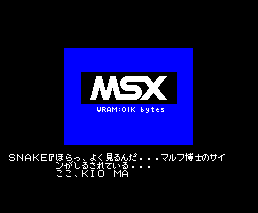
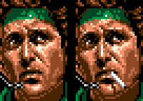

# Curiosidades

## Un monitor de depuración escondido

El último banco guarda la herramienta de los programadores: pausa, visor de
la VRAM y de los sprites, las coordenadas de Snake y trampas de teclado.
Está entero y lo apagan **dos bytes**. Todo, con sus teclas, en
[El monitor](EL-MONITOR.html).

## Los dos huevos: una boa y un búho

En el equipo hay **dos huevos** (タマゴ, las cosas 0x0E y 0x0F), y los dos se
incuban solos, contando cuadros del juego:

- El **0x0E**: al cogerlo (`p03:BD33` → `p10:A1C1`) cuenta 2 x 0x200 cuadros
  (unos 87 s en el MSX) y su dibujo en F3 cambia dos veces (`p10:A204`). Al
  acabar sale la ficha `0xE1D8`, de dos sprites (`p10:A234`), que va a por las
  raciones C que lleve Snake, la B3, la B2 y la B1, y se las come
  (`p10:A24D`). Es la boa de la que habla Norden: «se come de todo; las
  raciones le encantarán, tíralas cuando llegue a la cáscara del huevo»
  (`p49:A2FD`).
- El **0x0F**: cuenta 0x600, 0x300, 0x80 y 0x20 cuadros (unos 3 min 30 s)
  cambiando de dibujo, y luego alterna dos pasos para siempre; en uno, si
  Snake lo lleva puesto, suena el sonido 0x26 (`p11:BC62`). Es el búho:
  Norden dice que el búho de Zanzíbar ulula al ponerse el sol y que allí lo
  usan de reloj (`p49:A1CD`). Con él puesto, en la sala 0x0E de la zona 0x0A
  un actor cambia de paso (`p05:A035`) y la fase de la partida pasa al menos
  a 8 (`p05:A0C5`).

## El juego va a 12 cuadros por segundo

Jugando, el juego procesa un cuadro cada 5 del VDP (a veces 6): en openMSX,
el contador `0xCA03` sube 709 veces en 3.600 cuadros, un minuto
(`tools/lanza_ritmo.ps1 -modo partida`). Es el ritmo de todos los GIF de la
partida de esta web.

## VRAM:OIK bytes

En la charla del final, Snake pide meter en un MSX el cartucho del doctor
マルフ: «そのままMSXにさしこんでみろ» (`p50:9DB5`). La pantalla que sale es la
de arranque de un MSX, con **«VRAM:OIK bytes»**:

Snake: «mira bien... está la firma del doctor マルフ... aquí, KIO MA...»
(`p50:9E6C`); ホーリー: «ah, es verdad... está al revés» (`p50:9EA6`). «VRAM:OIK»
leído al revés es **«KIO:MARV»**.

## Konami y el MSX, dentro del juego

ペトロ cuenta que マルフ era un maníaco de los juegos y escondió los planos de
OILIX en un microfilm, en la placa de un cartucho: «コナミというニホンのゲーム
メーカーのMSXカートリッジらしい», un cartucho de MSX de una empresa japonesa
llamada Konami. Snake contesta que el MSX es el ordenador con más máquinas
vendidas del mundo (`p50:8E6D`). El cartucho está en el equipo:
«カートリッジ: マルフののこしたゲームカートリッジ» ([Snake](SNAKE.html)).

## La radio del 140.07

Con el **tabaco** puesto, sin alerta, fuera del ascensor y de las especiales
2 y 0x2A, marcar **140.07** en el transceptor (`p09:BF42`) pone una de **16
músicas al azar** según el contador de cuadros (`p09:BFB5`, tabla
`p09:BFC1`): 0xA9, 0xAA, 0x99, 0x9A, 0x9C, 0x9D, 0x9E, 0x9F, 0xA2, 0xA3, 0xA4,
0xA0, 0x73, 0x7A, 0x7B y 0x81. Ejecutado en el cartucho: con el tabaco, cada
valor del contador da su música; sin él, ninguna. Tres de ellas, la 0x7B, la
0xA9 y la 0xAA, **solo suenan en esa radio**.

Y con el tabaco el retrato de Snake lleva otra pieza encima, el cigarro en la
boca (`p01:70C9`, `p44:95D1`):

## Dos músicas que no pide nadie

La **0x6B** y la **0x6E** tienen su rutina (`p01:6B22`, `p01:6B2E`) y su
partitura, pero ninguna llamada, tabla ni `ld a,` las pide: la dirección de
sus rutinas no sale en ningún banco (la de la 0x6E, solo como un byte de una
sala, en `p24`). Medido barriendo la ROM. Están en [La música](LA-MUSICA.html).

## Un 140.99 que al cargar es 140.98

Tras el mensaje `p48:9D50`, el juego ejecuta la conversación 30 de la lista
de `p48:800C` (`p06:B054`): pone la bandera 0xA2 y la frecuencia de マスター
(140.38) pasa a **140.99**. Al seguir la partida guardada, la lista se rehace
(`p09:B62F`) y, con esa bandera, se queda en **140.98** (`p09:B66D`).
Ejecutado en el cartucho: 0x38, 0x99 tras `p06:B054`, 0x98 tras `p09:B62F`.

El mensaje firmado por キャンベル pero que dice ser キャリー («papá se ha ido a
pescar... se llevó la radio... la frecuencia es 140.99») no lo apunta ningún
puntero de la ROM: solo sale en la lista de 36 de `p48:800C`, que sirve para
reconocerlo, no para ponerlo. Si el juego llega a enseñarlo, no está
contrastado jugando.

## SNATCHER

ケスラー cuenta lo que pasó con BIG BOSS tras la caída de OUTER HEAVEN: sobrevivió
sin las manos, las piernas, el ojo y la oreja derechos; un tirano del Este se
fijó en él, metieron prisa al **«ペトロビッチ・マッドナーのSNATCHERケイカク»**, el
plan SNATCHER de Pettrovich Madnar, y lo escogieron para el experimento
(`p49:B61E`).

## Lo que Snake recoge y tira

«を、ニュウシュした。 / しかし、つかいみちが ないのですてよう！»: lo ha cogido,
pero no sirve para nada y lo tira (`p51:B1D9`, `p51:B1E4`). Son diez: espinas
de pescado, una caca de paloma, una piel de serpiente, el brazo derecho de un
maniquí, una rata muerta, una **«バグチェックリスト»** (una lista de fallos), una
colilla, una piel de plátano, **«コナミ　パラダイム»** y una botella vacía
(`p51:B1F9-B244`).

## Modo de empleo: desconocido

Siete descripciones del equipo acaban en «シヨウホウホウはフメイ», el modo de
empleo es desconocido: el mechero (un «100エンライター» de «JR TOKAI»), el
tabaco, el ala delta («戦場でのリヨウカチはなし», no vale para nada en el campo
de batalla), la caja de cartón, el cubo de basura, el huevo y el broche. Y la
manta de camuflaje es «あらゆるVRAMにタイオウできる», **compatible con
cualquier VRAM**. Todas en [Snake](SNAKE.html).

## Erratas del cartucho

- La tarjeta verde se llama «グレーン　カード» (`p51:B38F`) y su descripción
  dice «グリーン・カード» (`p51:BD46`).
- «ボデイ・アーマー» (`p51:B33C`) y, en su descripción, «ボディ・アーマー»
  (`p51:B8F2`).

## Los créditos del final, seis veces más lentos

Los créditos sobre el sol duran 40,5 segundos si el código corre sin esperar
al VDP; en el MSX, **249,8**: cada cuadro borra y copia rectángulos con el VDP
y el juego espera a que acabe cada orden ([Las secuencias](LAS-SECUENCIAS.html)).

## La entrada se aclara

En la zona 0, al subir a la fila 3 y luego a la 4, `0xCAAD` pasa a 1 y a 2
(`p02:8181`) y la paleta se aclara: en el mapa, la parte de abajo es más
oscura ([Los mapas](LOS-MAPAS.html)).

## Lo que el listado tenía mal

Al ejecutar el cartucho para dibujarlo salieron errores del listado, ya
corregidos:

- En `p12` se llamaban «patrones» los colores de los sprites de Snake, y al
  revés: lo cazó mirar el registro R#6 con el juego en marcha.
- Las fichas de `0xD800` se daban como 22 tipos: son **11**, con una tabla de
  dibujos por tipo (`p04:8A75`) y otra de lógica por tipo menos uno
  (`p04:8A8D`).
- Los comentarios de `mira_condiciones` (`p01:6104`) decían las condiciones al
  revés; las 3.000 pruebas de [El transceptor](EL-TRANSCEPTOR.html) lo
  cazaron.
- El orden vertical de las salas: la fila **sube** al salir por arriba
  (`p02:8117`).
- Los pasos de la tabla de RUNNING MAN (`p05:AC48`) se llamaban con uno o dos
  de menos desde `0xAD2F`: los pasos 7 y 8 repiten el 1 y el 2. Salió al
  acabar su pelea. Lo mismo con los de GREY FOX (`p05:B934`), con tres de
  menos desde `0xBBA2`: los pasos 0x0D-0x0F van todos a un `ret` (`p05:BA57`).

## Preguntas abiertas

- **El dibujo 7 de Snake** (la vuelta gateando, en el estado 0x0B) no ha
  salido jugando: sus patrones son de Snake tumbado y se pintan partidos.
- **Los tipos de actor 0x03, 0x08, 0x0B, 0x18 y 0x19** no están en ninguna
  sala.
- **La especial 0x2D** (su sala 1) no está cotejada: en openMSX Snake muere al
  entrar.
- Unos pocos puntos (de 4 a 25) de las luces de los botones de los ascensores
  y del número de planta de la zona 0x10 salen distintos de openMSX sin
  explicar.
- El mensaje de キャリー del 140.99 (arriba).
- La conversación sin número de `p48:84B1` encadena, un cuadro detrás de
  otro, trozos de los mensajes de ケスラー empezados a media frase: no está
  visto si el juego la usa.
- Las trampas del monitor marcadas como «leído» ([El monitor](EL-MONITOR.html)).
