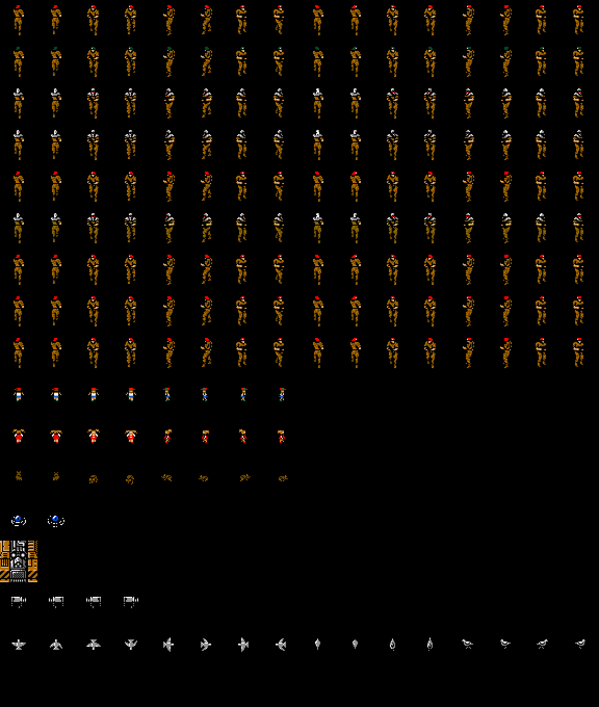

# Los enemigos

Los enemigos son **actores** de la zona, no de la sala: cada uno lleva su
fila y su columna y va de sala en sala. En los mapas hay **155** en las salas
y **52** en las especiales, todos en su sitio de salida y ninguno en alerta
([Los mapas](LOS-MAPAS.html)).

Cada tipo tiene su tabla en `p56:A808` (por el tipo): un ancho y, detrás, una
fila de parejas [desplazamiento] [patrón] por dibujo; los desplazamientos son
palabras de `p56:A7EE` (Y en el byte bajo, X en el alto) que se suman al sitio
del actor, y `sprites_de_actores` (`p12:7DDC`) los pone con los sprites que se
le repartieron y los colores del reparto (`p04:81C5`). Como los patrones los
carga cada sala, cada tipo se pinta en una sala donde está
(`tools/actores_dibujos.py`), solo él, en el centro y quieto.

Una fila por tipo, de arriba abajo:

| Tipo | Dibujos | Pintado en | Qué es |
|---|---:|---|---|
| 0x01 | 16 | zona 0x00, sala 1 | soldado |
| 0x02 | 16 | zona 0x01, sala 0x13 | soldado |
| 0x04 | 16 | zona 0x03, sala 0 | soldado |
| 0x05 | 16 | zona 0x03, sala 0x10 | soldado |
| 0x06 | 16 | zona 0x04, sala 0x16 | soldado |
| 0x07 | 16 | zona 0x0A, sala 0x0E | soldado |
| 0x09 | 16 | zona 0x04, sala 8 | soldado |
| 0x0A | 16 | zona 0x04, sala 0x0D | soldado |
| 0x0C | 16 | zona 0x01, sala 0x0D | soldado |
| 0x10 | 8 | zona 0x06, sala 2 | figura pequeña de gorra roja |
| 0x11 | 8 | zona 0x04, sala 5 | figura pequeña con coletas |
| 0x12 | 8 | especial 0x39, sala 1 | animal pequeño: la sala está llena |
| 0x13 | 2 | zona 0x06, sala 1 | cúpula azul |
| 0x14 | 1 | zona 0x08, sala 3 | máquina de 48 x 48 puntos |
| 0x15 | 4 | zona 0x01, sala 0x0A | cámara |
| 0x16 | 16 | zona 0x0F, sala 3 | pájaro |
| 0x17 | 3 | zona 0x0F, sala 3 | un punto de 4 x 4, con los pájaros |

Los soldados comparten la tabla (`p56:A852`): lo que cambia entre ellos es lo
que hacen (la rutina de cada tipo, `p04:815B`) y los colores.
En la zona 3, sin alerta, los colores son los de `p08:BA2F` (la cabeza
blanca); con la alerta, el tipo lleva el bit 7 y vuelven los de siempre.

Los tipos 0x03, 0x08, 0x0B, 0x18 y 0x19 tienen su tabla de dibujos pero no
están en ninguna sala, así que no hay patrones cargados con los que pintarlos.
