# Los jefes

Las peleas no son actores: son **fichas de 0x20 bytes en `0xD800`** (cuatro;
en las salas especiales, la de `0xD860`). Al entrar en una zona,
`fichas_d800_de_la_zona` (`p12:6BA5`) las rellena desde las filas de `p56`
[tipo] [Y] [X] [fila] [columna] [vida]. Hay **11 tipos**: el dibujo de cada
uno va por la tabla de `p04:8A75` y su lógica por la de `p04:8A8D`; cuando se
queda sin vida (`resta_a_d800`, `p07:B471`) pasa a los pasos 0x20 y
siguientes (`p04:8AD8`), y al acabar deja hecho lo suyo (`p06:B155`): las
banderas de la partida y, algunos, la fase.

## El orden

Lo dice la **fase de la partida** (`0xCA22`), que suben los finales de las
peleas: BLACK COLOR la pone en 1, RUNNING MAN en 2, el HIND D en 3, los
ULTRABOX en 6 y Pettrovich en 9 (`p06:B16B-B1CA`); la 4 la pone una
conversación (`p06:AF9D`), la 5 el final de la escena 5 (`p09:ADC7`) y la 8 el
búho en la zona 0x0A (`p05:A0C5`, ver [Curiosidades](CURIOSIDADES.html)). La 7
no la escribe ningún código: solo se lee al cargar una partida (`p12:635A`). Y dos cadenas en el código: al
morir NIGHT SIGHT sale Pettrovich, y tras METAL GEAR vienen GREY FOX y BIG
BOSS (`p04:8C23-8CFB`). RED BLASTER y PREDATOR no tocan la fase: su sitio en
la lista es el de su zona en la partida, no está medido.

## Cómo están hechas

Cada pelea la **juega el cartucho ejecutado** (`tools/jefes.py`): se entra en
su zona y su sala, se corre el cuadro entero del juego (`p01:728E`, el de la
interrupción) con los mensajes pasados con el disparo y la vida de Snake
llena, y al final se le quita al jefe la vida para ver cómo acaba. Los GIF
van **al ritmo del MSX**: jugando, el juego procesa un cuadro cada 5 del VDP
(medido en openMSX, ver [Por dentro](POR-DENTRO.html)). Una imagen quieta de
más de 4 segundos (un mensaje que espera) se deja en 4.

Los patrones de los jefes los carga el juego al acabar la llamada del
principio (`p09:B82F`): cotejados con openMSX en la sala de PREDATOR, iguales.

## 1. BLACK COLOR (zona 0x03)

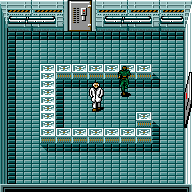

El científico que se transforma. Sus mensajes lo firman «BLACK COLOR»
(`p50:8807`), y `p50:887B` dice quién es: Kyle Schneider.

## 2. RUNNING MAN (especial 0x29)

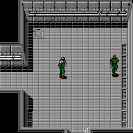

«オレはRUNNING MAN» (`p50:8BDA`). En el cartucho ejecutado la pelea se queda
en el mensaje de su paso 0x10, «見てろっ！！».

## 3. HIND D (zona 0x07)

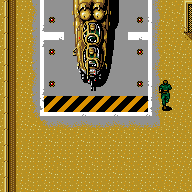

El helicóptero de la pista. Está hecho de caracteres de la pantalla, no de
sprites, con su sombra; al morir acaba como los misiles (pasos 0x20 y
0x2A-0x2D). Lo nombra ケスラー: «HIND・D» (`p49:AF2E`).

## 4. RED BLASTER (zona 0x0E)

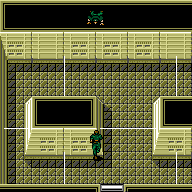

«おれはRED BLASTER» (`p50:8D64`), con sus granadas.

## 5. ULTRABOX (zona 0x0B)

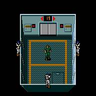

Cuatro a la vez, dentro del ascensor: al llegar a la planta 0x13 (`p07:A248`)
el paso 0x0F pone `0xD8A0` y salen las cuatro fichas (`p05:AA90`) con su
escena (`p05:AB08`). «BOX『おれたちはみっ室専門のアンサツブタイULTRABOXだ』»
(`p50:8DE4`). Arden al morir.

## 6. PREDATOR (zona 0x0A)

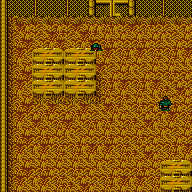

«プレデター『本物のヘビかどうかためしてやる』» (`p50:8D95`).

## 7. NIGHT SIGHT (zona 0x13)

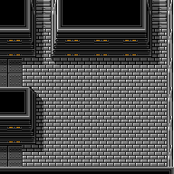

Empieza con una llamada del transceptor. Lo nombra ケスラー (`p49:B233`).
En la pelea no se le ve: va con «el último traje de camuflaje, invisible» y
una pistola que no suena (`p49:B9BA`). Al morir saca la ficha de tipo 8.

## 8. Pettrovich (zona 0x13)

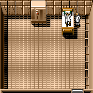

ペトロビッチ・マッドナー, el doctor: sus mensajes son los 0x14-0x17 de
`p50:8E35-9182` y el nombre entero lo da ケスラー (`p49:B61E`). La ficha se
queda en su paso 0x11, que espera un suceso de la partida (el bit 5 de
`0xD7D9`, `p05:BFA0`).

## 9. METAL GEAR (zona 0x12)

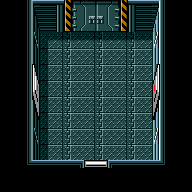

El robot, de caracteres, en **pantalla partida**: arriba la pelea con su
desplazamiento vertical y abajo el marcador, cambiando el registro R#23 a
media pantalla. En esta zona el juego pone a Snake en la sala 3
(`p00:5ADF`), y a la pelea se entra en la sala 8 por la puerta 8, de tipo 5;
el robot se dibuja una sola vez (`p04:88B7`). La pantalla partida, montada
como la monta la interrupción de línea, está cotejada con openMSX: 224 puntos
distintos de 54.272, un objeto lanzado y la barra de vida. Snake lo llama
«シンガタMETAL GEAR», el METAL GEAR nuevo (`p50:9182`).

## 10. GREY FOX (zona 0x12)

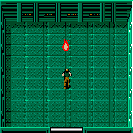

Con su conversación (`p50:990C`). Así, «GREY FOX», en los textos. Sus pasos
5 a 0x10 esperan sucesos de las salas 2 y 3 (`0xD88C`).

## 11. BIG BOSS (zona 0x12)

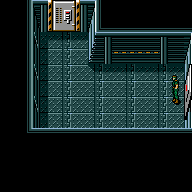

Sus mensajes, `p50:92BB` y `p50:92FF`. El paso 0 espera `0xD6B0`: en el
cartucho ejecutado se ve desde que se le quita la vida, y sus colores cambian
de un cuadro a otro. Esta pelea, la de GREY FOX y la de NIGHT SIGHT no están
cotejadas con openMSX.

## La música

Las peleas de los tipos 2, 3, 4, 6, 7 y 0x0A y la de los ULTRABOX suenan con
la **0x84**; la del HIND D, con la **0x91** ([La música](LA-MUSICA.html)).
