# Los mapas

El juego tiene **20 zonas** con **274 salas** y **57 especiales** (lo que hay
detrás de una puerta: almacenes, despachos, ascensores), que suman otras 75
salas. Cada zona es una
rejilla de salas (`p30:B8A5`, que `p02:804E` despliega en `0xD900`); una sala
de 0x80 o más en la rejilla es el paso a la zona 0x80 menos eso. Las salas
especiales tienen su rejilla en `p30:BA18` y se pintan con las piezas de la
zona desde la que se entra (`p15:B4B5`).

Todo lo de esta página lo **pinta el cartucho ejecutado**: se entra en cada
sala como entra el juego (`tools/mapas.py`), se corren cinco cuadros del
bucle de la partida y se guarda la pantalla, con la paleta de la sala. Las
274 salas y 74 de las 75 de las especiales están **cotejadas con la VRAM de
openMSX** en partidas llevadas sala a sala; lo que sale distinto es
animación (cámaras, cintas), azar o un mensaje abierto, y está explicado en
[Por dentro](POR-DENTRO.html).

Encima van los enemigos de cada sala, pintados por sus propias rutinas
(`p12:7DDC`), y los rótulos:

- en amarillo, el número de la sala;
- `Exx`, la puerta a la sala especial xx; `Zzz`, el paso a la zona zz
  (`Zzz:ss`, a su sala ss); `->ss`, la puerta a la sala ss;
- debajo de cada zona, sus especiales: `Exx <- ss #n` es la especial xx, a la
  que se entra desde la sala ss por la puerta n.

Las filas **suben** hacia arriba: salir por arriba suma una fila (`p02:8117`).

## Zona 0x00 (13 salas)

La entrada, con los camiones, los almacenes de abajo y el paso a la
zona 1. Al subir a la fila 3 y a la 4, la paleta se aclara (`0xCAAD`,
`p02:8181`): la parte de abajo sale más oscura.

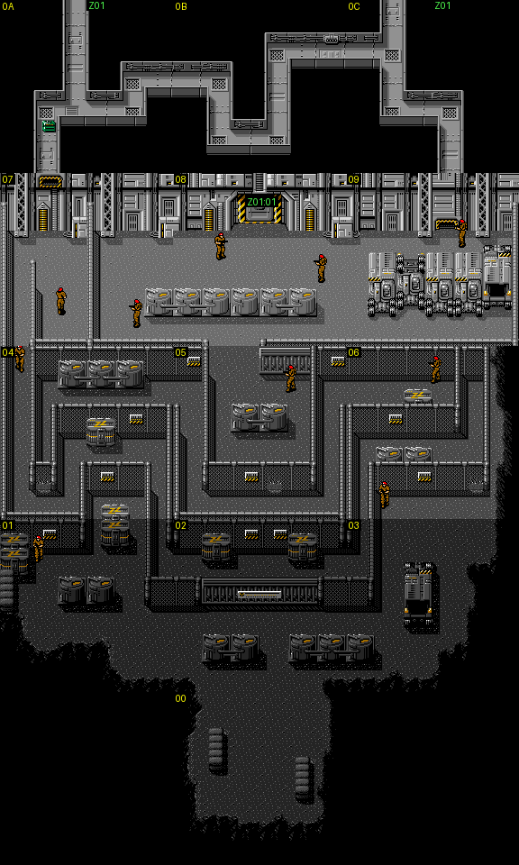

## Zona 0x01, la planta 1F (23 salas, 4 especiales)

El ascensor lleva el rótulo **1F**.

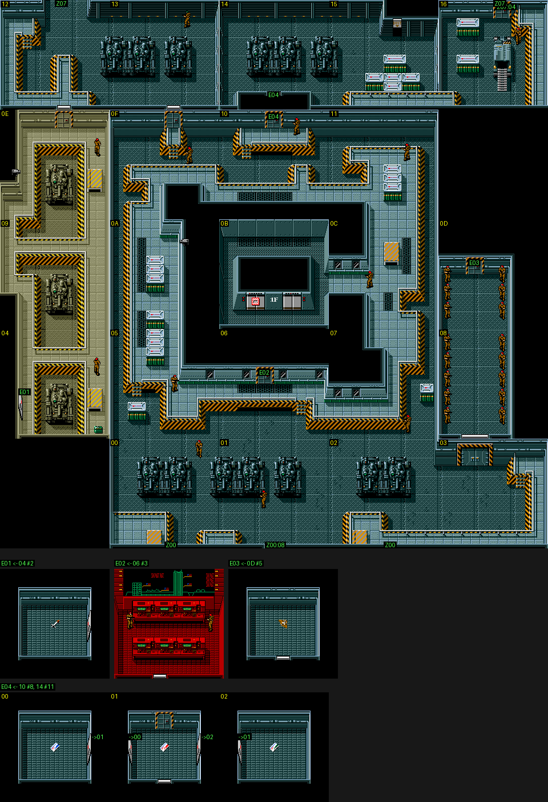

## Zona 0x02, la planta 2F (9 salas, 2 especiales)

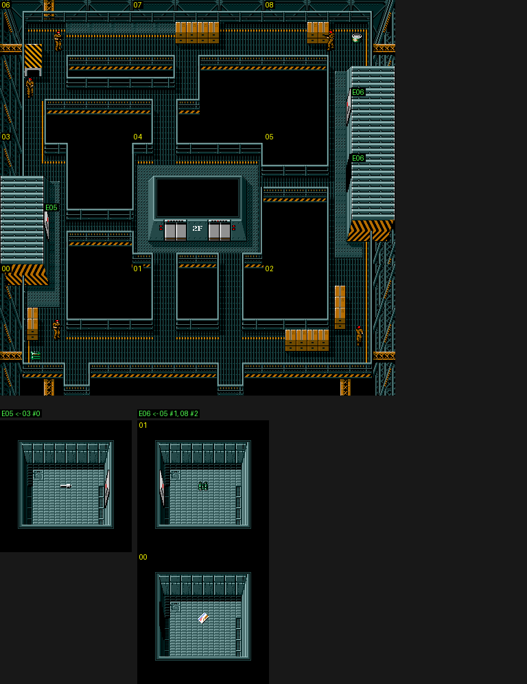

## Zona 0x03, la planta 3F (21 salas, 8 especiales)

Aquí se pelea con BLACK COLOR. Las salas 1, 2 y 7 tienen gas: al entrar, la paleta parpadea
(`p03:BAE8`, `p03:BC29`).

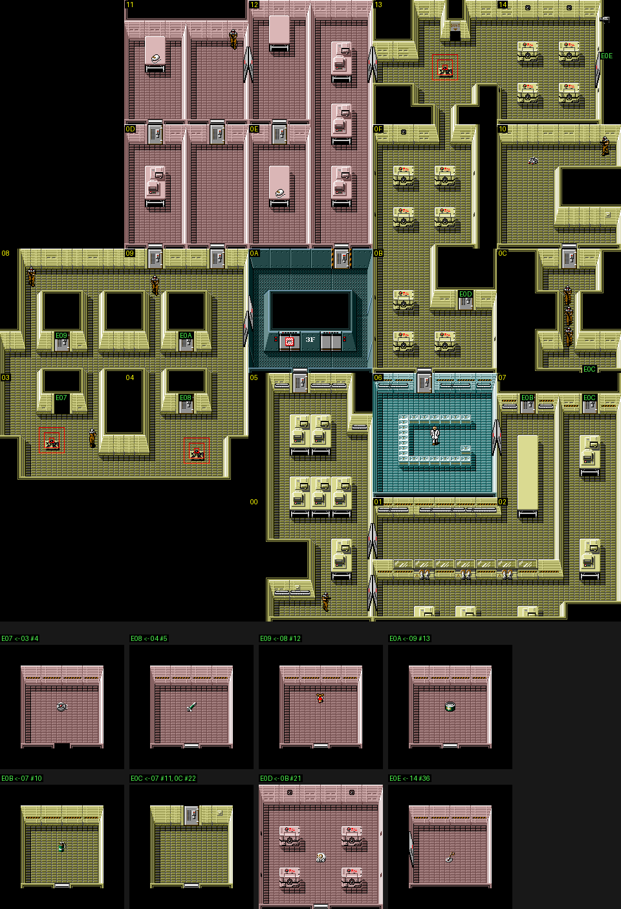

## Zona 0x04, la planta 4F (24 salas, 10 especiales)

Los dormitorios, el comedor y los aseos. Los soldados de la sala 6 salen en
una de **cuatro colocaciones al azar** (`p12:6A28`): la del mapa es una de
ellas.

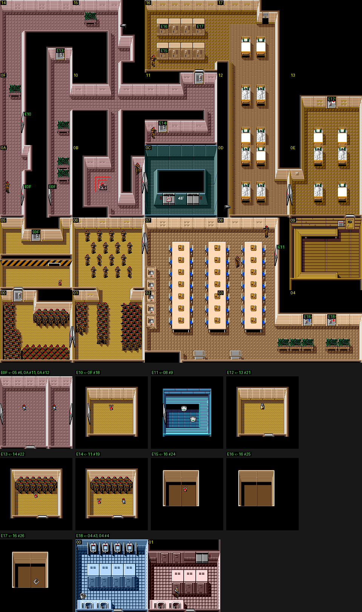

## Zona 0x05, la planta B1 (9 salas, 13 especiales)

Los almacenes de armas.

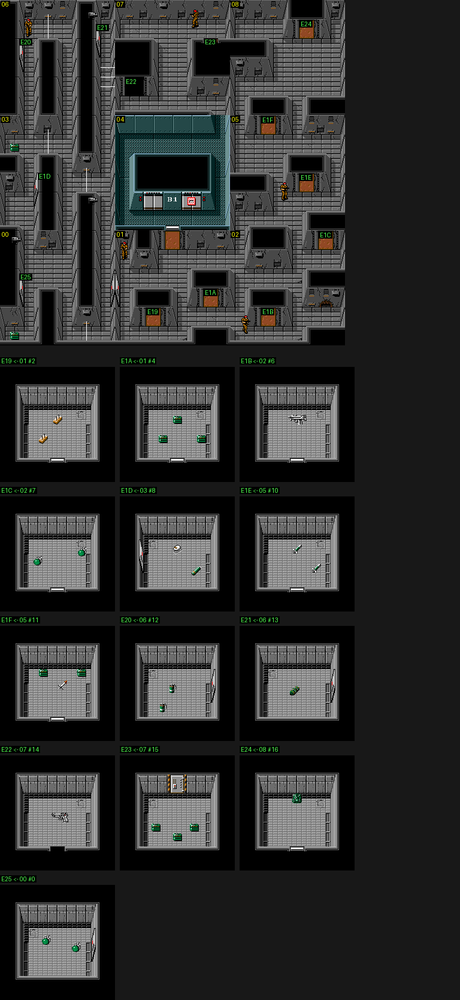

## Zona 0x06, la planta B2 (36 salas, 3 especiales)

El canal de agua.

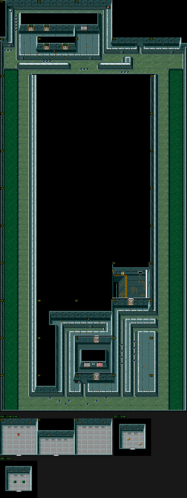

## Zona 0x07 (21 salas, 2 especiales)

La selva, el pantano y la pista del helicóptero: aquí se pelea con el
HIND D, y en la especial 0x29 con RUNNING MAN.

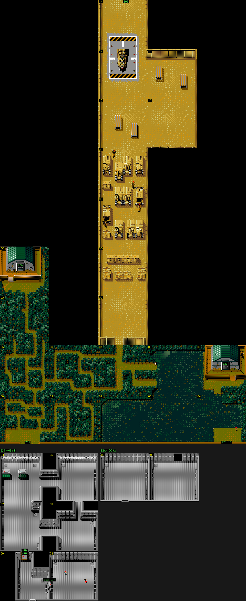

## Zona 0x08 (16 salas)

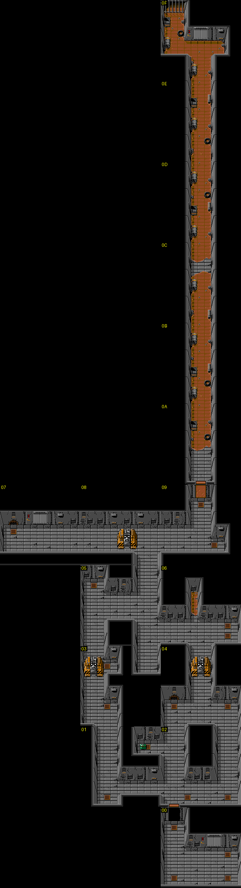

## Zona 0x09 (5 salas)

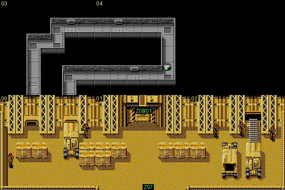

## Zona 0x0A (25 salas, 7 especiales)

El exterior: el campo, las casetas y los almacenes. Las rayas de la sala
0x0E cambian de color en cada cuadro (`p10:BC59`). Aquí se pelea con PREDATOR.

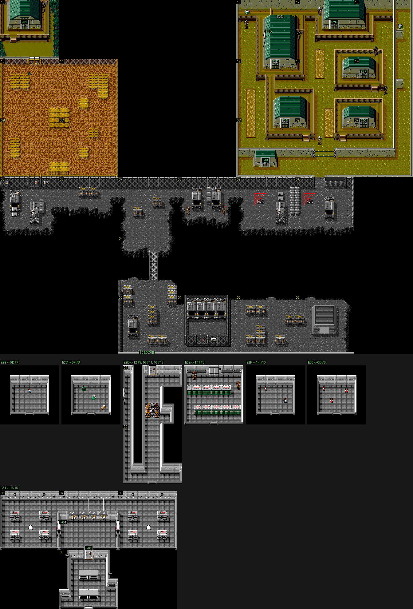

## Zona 0x0B (9 salas, 1 especial)

En su ascensor esperan los cuatro ULTRABOX.

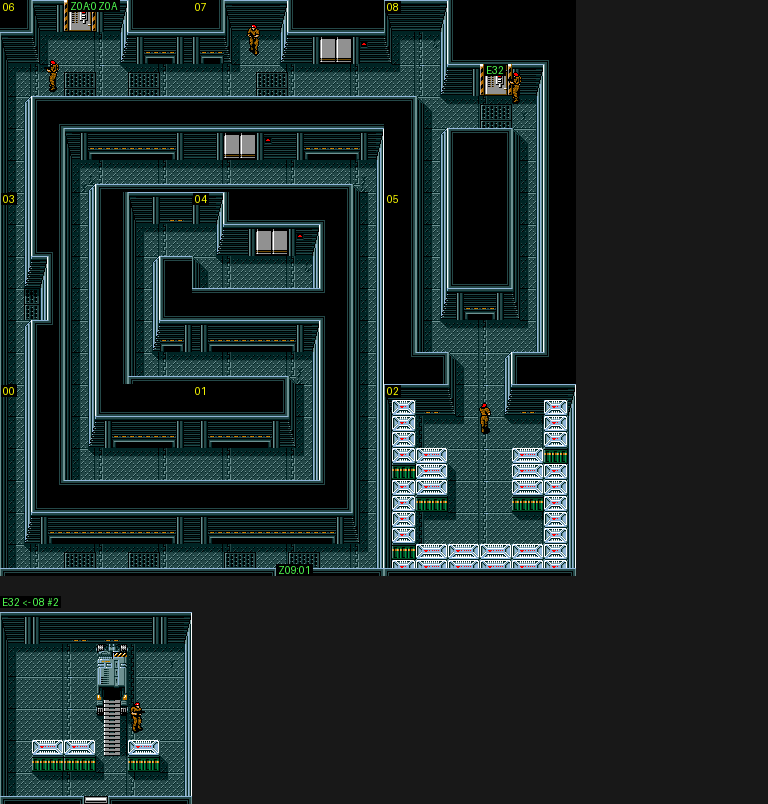

## Zona 0x0C (9 salas, 2 especiales)

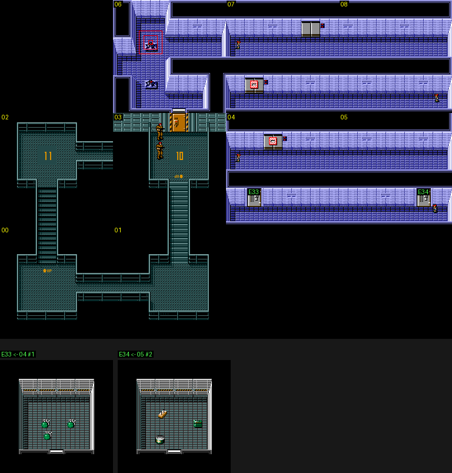

## Zona 0x0D (7 salas, 3 especiales)

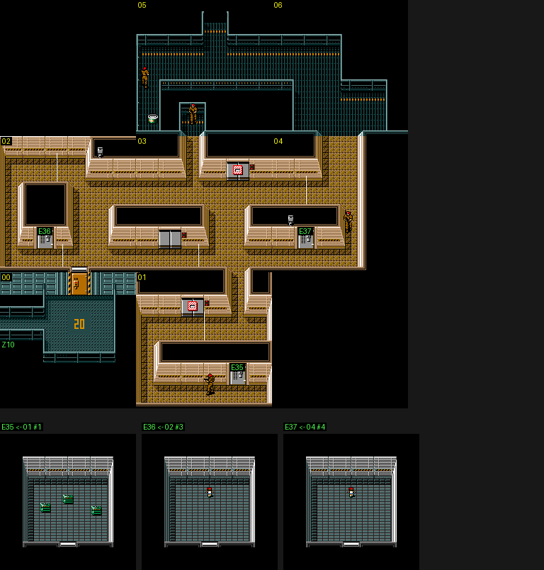

## Zona 0x0E (6 salas)

Aquí se pelea con RED BLASTER.

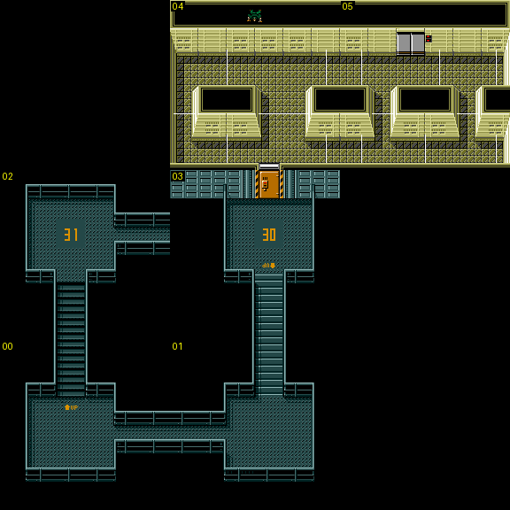

## Zona 0x0F (5 salas)

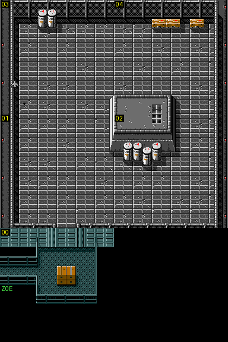

## Zona 0x10 (4 salas)

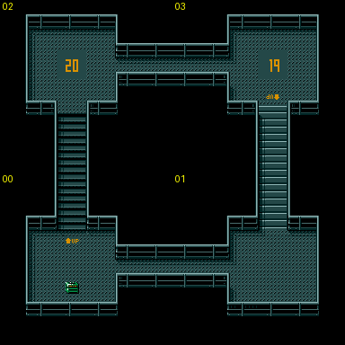

## Zona 0x11 (6 salas)

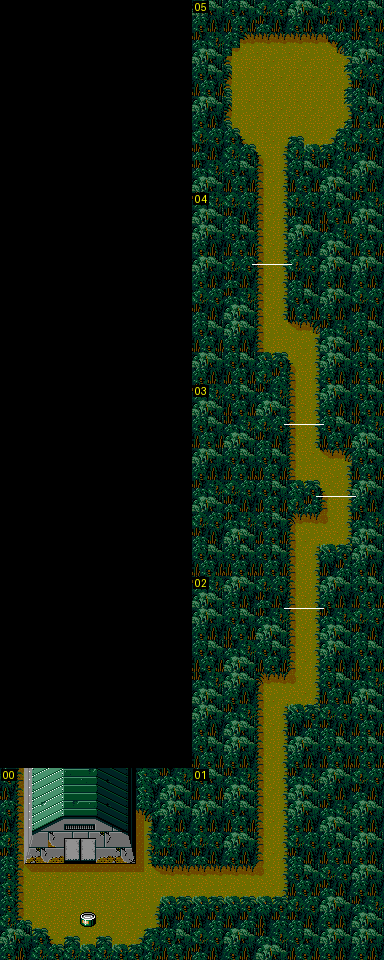

## Zona 0x12 (20 salas, 1 especial)

La de las peleas con METAL GEAR, GREY FOX y BIG BOSS.

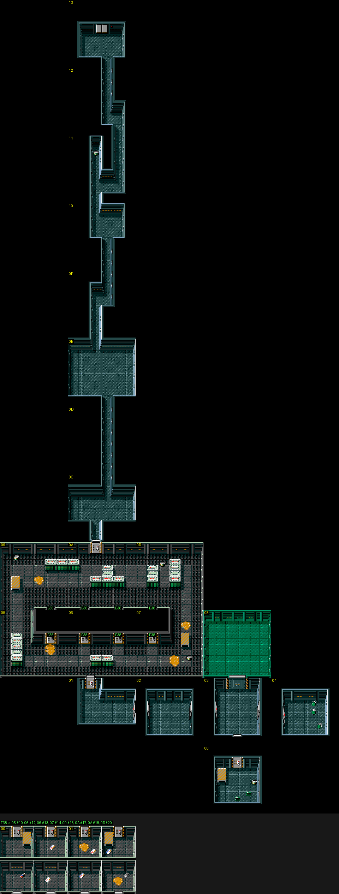

## Zona 0x13 (6 salas, 1 especial)

Aquí se pelea con NIGHT SIGHT, y aquí está Pettrovich.

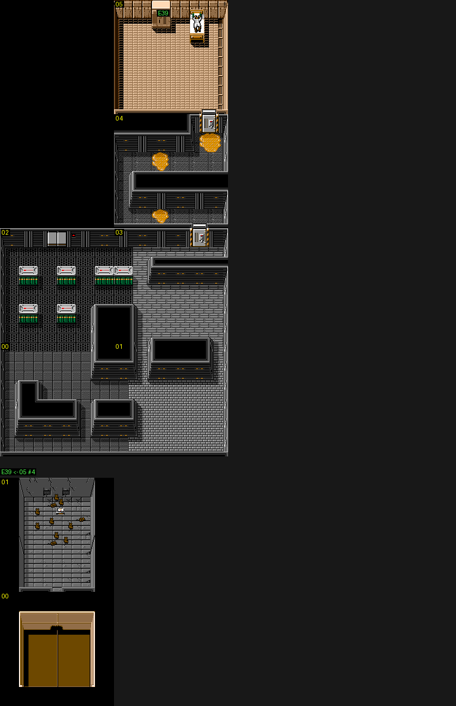
