# Snake

## Lo que hace

Jugado por el cartucho con el mando emulado (`tools/snake.py gif`): cada
cuadro, las teclas a `0xCA08` y `0xCA07` y el bucle de la partida
(`p01:741A`), y se pinta la sala entera, como en la pantalla, al ritmo del
MSX (un cuadro del juego cada 5 del VDP, medido en openMSX). Es la sala 0 de
la zona 0, donde empieza la partida.

**Andar**, arriba, izquierda, abajo y derecha:

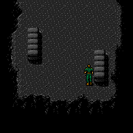

**Arrastrarse** (los dos disparos a la vez para echarse):

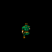

**El golpe** (el disparo 2, `disparo_2`, `p03:A360`: el estado 3 durante 4
cuadros), en las cuatro direcciones; el disparo 1 usa el arma:

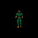

**Con la pistola** (`0xCB20` = 1):

**Dentro de la caja de cartón** (ダンボール, `0xCB21` = 0x0A): un solo dibujo,
el 0x0B, con sus colores fijos (`p12:7AE5`), que se desliza:

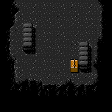

**Bajo el cubo** (バケツ, `0xCB21` = 0x0B):

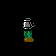

## Todos sus dibujos

Cada dibujo una sola vez (los que a la vista son iguales, quitados), una fila
por número de dibujo: 0, 1, 2, 3, 4, 8, 9, 0x0A, 0x0B, 0x0C y 0x0E. El 9
(`p63:B27A`) parece el 0 pero no lo es: cada imagen cambia en 20 a 67
puntos.

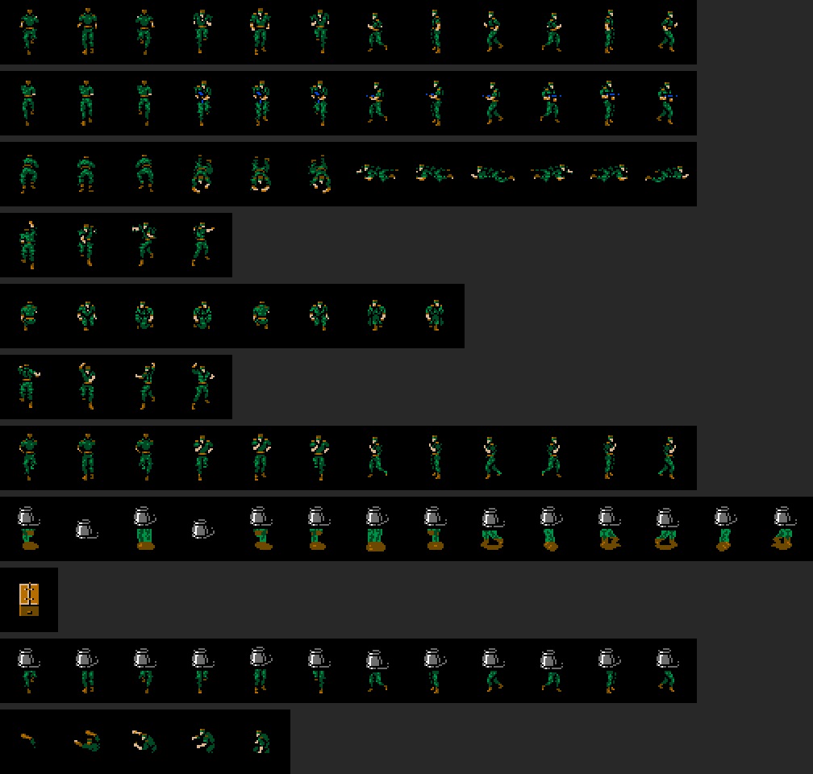

## Cómo se pinta

Snake son **cuatro sprites de 16 x 16**: dos arriba y dos 16 puntos más
abajo, y en cada pareja el segundo lleva el bit CC, que suma sus colores a
los del primero (`dibuja_snake`, `p12:7688`). Sus patrones no son fijos:
cada cuadro se copian a la tabla de patrones de sprites (`0xF800`), desde la
página 3 de la VRAM, los cuatro del dibujo que toca (`p12:76E9`), y sus
colores salen, línea a línea, de las rachas de `p63:B282` y `p63:B620`. El
dibujo es `0xCB01`; recorriendo sus tablas (`p63:B1CC-B282`) salen 98
distintos. La partida empieza con el 0x0D, que deja los sprites fuera, hasta
que Snake llega. El 7 (darse la vuelta arrastrándose) no ha salido jugando.

## Las armas (F2)

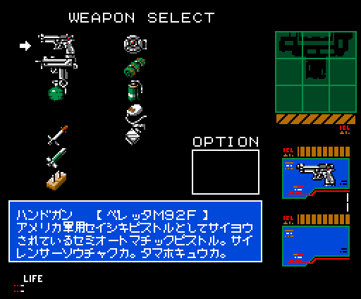

Snake lleva sus cosas en fichas de cuatro bytes: **13 armas** en `0xD600` y
**34 cosas de equipo** en `0xD638` ([la tiene] [la cuenta, en BCD] [...]).
F2 abre la pantalla de armas (`p10:AED6`) y F3 la de equipo (`p10:AF30`); el
letrero de lo que hay bajo el cursor sale de la tabla de `p50:8046` o de
`p50:8048` (`letrero_de_lo_elegido`, `p10:B8C7`). Las dos pantallas, con todo
puesto, las pinta el cartucho (`tools/equipo.py`).

Los letreros de F2, tal como los tiene la ROM:

<!-- generado:armas -->
| Casilla | | | Letrero |
|---:|---|---|---|
| 0 | | | (ninguna) |
| 1 | 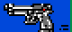 | `p51:B546` | **ハンドガン ［ベレッタM92F］** アメリカ軍用セイシキピストルとしてサイヨウされているセミオートマチックピストル。サイレンサーソウチャクカ。タマホキュウカ。 |
| 2 | 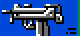 | `p51:B59A` | **サブマシンガン ［イングラムM11］** アメリカのコガタケイリョウSMG。ショットキーをおしつづけるとフルオートになる。サイレンサーソウチャクカ。タマホキュウカ。 |
| 3 | 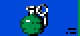 | `p51:B5ED` | **グレネード ［M68］** アメリカセイ、チャクハツシンカンシキハヘンシュリュウダン。ジメンにトウタツするとバクハツする。ラッカチテンはターゲット上。 |
| 4 | | | (ninguna) |
| 5 | 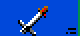 | `p51:B63B` | **タイクウミサイル ［スティンガー］** ケイタイシキ、タイクウミサイル。レーダー内のショウジュンをカーソルイドウさせ、ショットキーでハッシャする。レーダー内カノウ。 |
| 6 | 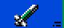 | `p51:B690` | **リモコンミサイル ［M47ドラゴン］** シュ動モクシセン指令ホウシキによりハッシャゴのミサイルとモクヒョウをモクシによるカーソルソウサでホウコウをシュウセイできる。 |
| 7 | 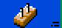 | `p51:B6E7` | **プラスチック・バクダン** ヘンケイカノウなケイリョウコウセイノウバクヤク。 |
| 8 | 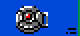 | `p51:B70E` | **ジライ ［M 78］** ショットキーでセット、ホフクで真上を通るとカイシュウ。タンチキがあればレーダー上にうつる。レーダー内にサイダイ16コセットカ。 |
| 9 | 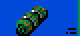 | `p51:B808` | **カモフラージュ・マット ［ファントム07］** あらゆるVRAMにタイオウできるカモフラージュ・マット。ショットキーでセット、真上を通るとカイシュウ。下に潜れば見えなくなる。 |
| 10 | 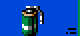 | `p51:B761` | **ムリョク化ガス ［ABC M25A2］** ボウドウチンアツ用シュリュウダン。バクハツするとCN1ガスをかざ下にフンシュツする。かざ上でのシヨウはキケン。 |
| 11 | 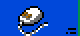 | `p51:B7B3` | **マウス ［ジェリー2］** シカケやセンサーを発見するのにつかうダミーロボット。物音モードのカイジョにもつかえる。ショットキーでプレイヤーの前方へはしる。 |
| 12 | 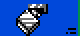 | `p51:B866` | **ライター ［JR TOKAI］。** どこにでもうっている100エンライター。シヨウホウホウはフメイ。 |
| 13 | | | (ninguna) |
<!-- /generado -->

## El equipo (F3)

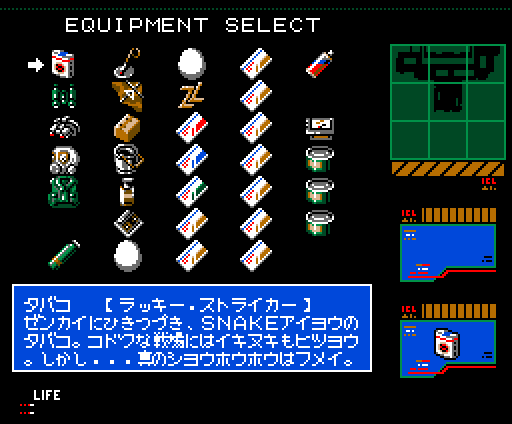

<!-- generado:equipo -->
| Casilla | | | Letrero |
|---:|---|---|---|
| 0 | | | (ninguna) |
| 1 | 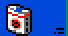 | `p51:B89A` | **タバコ ［ラッキー・ストライカー］** ゼンカイにひきつづき、SNAKEアイヨウのタバコ。コドクな戦場にはイキヌキもヒツヨウ。しかし・・・真のシヨウホウホウはフメイ。 |
| 2 | 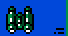 | `p51:BA39` | **ソウガンキョウ ［ニコス F500］** これをつかうとプレイヤーを中心に上下左右のガメンを見ることができる。 |
| 3 | 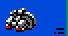 | `p51:BB19` | **ナイトビュア** クラヤミでも真ヒルのように見えるアンシゴーグル。これをソウビすればいかなるクラヤミでも見えるようになる。 |
| 4 | 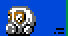 | `p51:B943` | **ガスマスク［ライアット・フェイス・マスク］** これをソウビするとドクガス・エリアでO2ゲージが2バイになり、へり方もおそくなりタイキュウ時間がのびる。ムリョク化ガスにもカ。 |
| 5 | 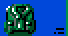 | `p51:B8F2` | **ボディ・アーマー ［S・P・S］** テキからのダメージがハンゲンするボウダンチョッキ。サイレント・パートナー・スペシャルといわれ、ジュウダンにのみユウコウ。 |
| 6 | | | (ninguna) |
| 7 | 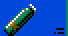 | `p51:B9E7` | **サンソボンベ** これをソウビすると水中でのO2ゲージが2バイになり、へり方もおそくなり潜水時間がながくなる。水上に上がればマンタンにもどる。 |
| 8 | 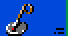 | `p51:B99F` | **ジライタンチキ** これをソウビするとジライがレーダー上にしろいコウテンとなってうつる。プレイヤーのしかけたジライもドウヨウにハンノウする。 |
| 9 | 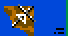 | `p51:BAF4` | **ハングライダー** 戦場でのリヨウカチはなし。シヨウホウホウはフメイ。 |
| 10 | 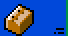 | `p51:BA77` | **ダンボール** タッキュウビンのどこにでもあるようなダンボールのハコ。ザンジバーランドいきのデンピョウがはられている。シヨウホウホウはフメイ。 |
| 11 | 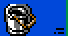 | `p51:BABF` | **バケツ** トイレそうじ用のカネセイのゴミバケツ。かなりじょうぶなシロモノだ。シヨウホウホウはフメイ。 |
| 12 | 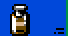 | `p51:BBF4` | **カゼグスリ ［PLカル ホワイト］** エン化リゾチームハイゴウのビエン用カゼグスリ。くしゃみ、はな水、はなづまり、なみだ目にきく。15サイ以上、1かい、1カプセル。 |
| 13 | 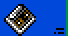 | `p51:BB84` | **カセットテープ** ナターシャのロッカーにあったカセットテープ。ザンジバーランドのコッカがロクオンされている。 |
| 14 |  | `p51:BB5A` | **タマゴ** バイオラボにあったタマゴ。たべられそうにはない。シヨウホウホウはフメイ。 |
| 15 | 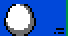 | `p51:BB5A` | **タマゴ** (= 14) |
| 16 | 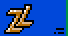 | `p51:BC4E` | **ブローチ** ナターシャがくれたブローチ。ザンジバーランドのマークがモチーフされている。シヨウホウホウはフメイ。ナターシャのにおいがする。 |
| 17 | 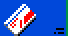 | `p51:BD04` | **レッド・カード** カード1から3をダイヨウするマスター・カード。 |
| 18 |  | `p51:BD25` | **ブルー・カード** カード4から6をダイヨウするマスター・カード。 |
| 19 | 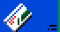 | `p51:BD46` | **グリーン・カード** カード7から9をダイヨウするマスター・カード。 |
| 20 |  | `p51:BCE7` | **カード** ザンジバーランドでシヨウされているICカード。 |
| 21 |  | `p51:BCE7` | **カード** (= 20) |
| 22 |  | `p51:BCE7` | **カード** (= 20) |
| 23 |  | `p51:BCE7` | **カード** (= 20) |
| 24 |  | `p51:BCE7` | **カード** (= 20) |
| 25 |  | `p51:BCE7` | **カード** (= 20) |
| 26 | 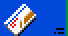 | `p51:BCE7` | **カード** (= 20) |
| 27 |  | `p51:BCE7` | **カード** (= 20) |
| 28 |  | `p51:BCE7` | **カード** (= 20) |
| 29 | 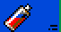 | `p51:BC94` | **スプレー ［ミセス・スプレー］** ジメチエーテル、LPガスをつかったキョウネンセイのラッカー用スプレー。カキゲンキンとかかれている。イロはメタリックグレイだ。 |
| 30 | | | (ninguna) |
| 31 |  | `p51:BBBC` | **カートリッジ** マルフののこしたゲームカートリッジ。この中にOILIXのマイクロフィルムがかくされている。 |
| 32 |  | `p51:BD68` | **Cレーション ［B1ユニット］** ショットキーでタイリョクのカイフクができるギュウニク、ブタニク、ハムエッグ、ツナフィッシュ、チョコレート、クラッカーをふくむ。 |
| 33 |  | `p51:BDBB` | **Cレーション ［B2ユニット］** ショットキーでタイリョクのカイフクができるマメとミートボールのトマトニ、マメとフランクフルト、ギュウニクのポテトニをふくむ。 |
| 34 | 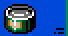 | `p51:BE0D` | **Cレーション ［B3ユニット］** ショットキーでタイリョクのカイフクができるスライスハム、ニワトリとシチメンチョウ、スパゲッティ、チーズ、コーヒーをふくむ。 |
<!-- /generado -->

## El radar

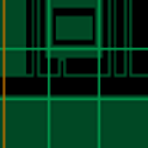

El recuadro de la derecha (`pon_radar`, `p12:6F49`) dibuja las **3 x 3 salas**
de alrededor de la de Snake desde el mapa de `0xD900` (`fondo_del_radar`,
`p12:6EC8`), una raya que lo barre (`p12:6D78`) y, al acabar cada barrido, un
punto por enemigo (`p12:6CE0`).

Cuando un enemigo ve a Snake (`alerta_sin_musica`, `p04:9955`) el radar se
cambia por la alerta 2: **危険** con LEVEL y LIFE; con la alerta 1
(`p04:934C`), **回避** con LEVEL y TIME. LEVEL es la alerta más uno (tope 3); LIFE, la vida
de Snake (`0xCA53`); TIME, la cuenta `0xD42B` entre 8 (`rotulos_de_alerta`,
`p04:984C`). El GIF lo juega el cartucho (`tools/radar.py`) en la sala 2 de
la zona 6, al ritmo del MSX: el radar solo, la alerta 2 a los 200 cuadros
(como la pone un enemigo que ve a Snake, `p04:9955`) y la 1 a los 300.

Los dibujos de las salas del radar (sus mapas de bits) están en la **RAM**
de `0x8000`, no en el cartucho: al entrar en la zona el juego pone su RAM en
esa ventana (`ENASLT` con el slot de `0xC386`) y los copia ahí
(`p00:5BE0`), y `dibujo_a_7000` (`p12:6F93`) los lee igual. Pintado sin esa
RAM, el radar sale lleno de ruido, como con interferencias.
