# El monitor de depuración escondido en el banco 63

El cartucho guarda, en el último banco, una herramienta de los programadores
que nunca llega a ejecutarse: un monitor de depuración con pausa, visor de la
VRAM, visor de sprites, coordenadas de Snake y trampas de teclado. Está
entero, pero desconectado con solo dos bytes.

## Dónde está y por qué no corre

La interrupción de cada cuadro (`p03:A127`) pone el banco 63 en 0xA000 y
llama a `p63:B800`. Si esa llamada vuelve con acarreo, ese cuadro el juego
no corre (`p03:A13A`). En `p63:B800` hay solo dos instrucciones:

```
B800  or a     ; sin acarreo...
B801  ret      ; ...y vuelve
```

Detrás, de 0xB802 a 0xBF6B (1.897 bytes, 952 instrucciones), está el monitor
completo. El trazado del cartucho no llegaba hasta ahí: se ha desensamblado
poniendo una semilla en 0xB802.

Para encenderlo basta con cambiar esos dos bytes por dos `nop`. Son el
desplazamiento 0x7F800 de la ROM (banco 63 × 0x2000 + 0x1800): `B7 C9` pasa a
`00 00`. `tools/rom_monitor.py` hace esa copia en `work/` sin tocar la ROM
original. Las capturas de abajo son de openMSX (máquina C-BIOS MSX2 japonesa)
con esa copia.

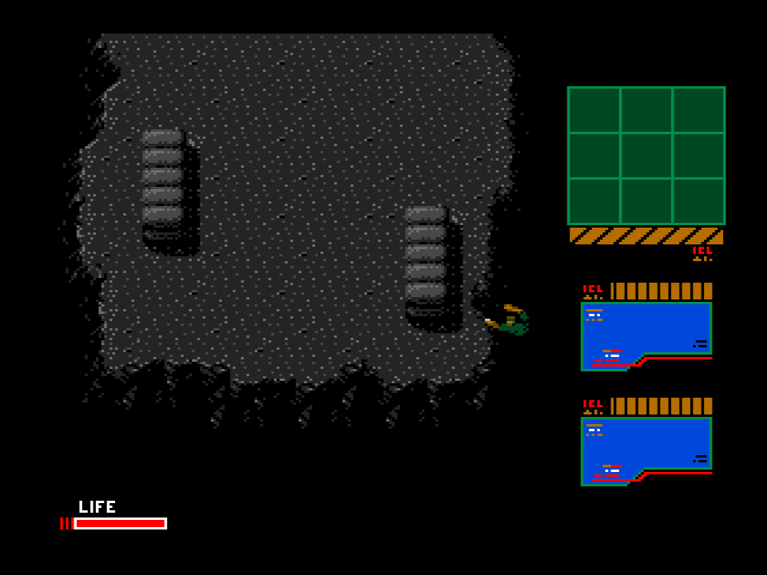

Con el monitor encendido el juego arranca y se juega igual: el monitor solo
lee el teclado cada cuadro.

## Cómo está hecho

- Lee el teclado directamente con la BIOS (`SNSMAT`, 0x0141), fila a fila, y
  no con las rutinas de mando del juego.
- Trae sus propias rutinas del VDP: escribir un registro, esperar a que acabe
  una orden, HMMM, HMMV, LINE, un marco, volcar a la VRAM con `otir` y leer
  un registro de estado. Para hablar con el VDP usa los puertos que anuncia la
  BIOS en 0x0006-0x0007. Las del juego, que están en el banco 0, aquí no se
  usan.
- Escribe los números en hexadecimal con la fuente que el juego tiene en la
  página 3 de la VRAM.
- Su estado va en 0xCA3E: 0 nada, 1 pausa, 2 visor de sprites, 3 cursor.

## Las teclas

"Visto" quiere decir comprobado en openMSX con la ROM parcheada. "Leído"
quiere decir que solo sale del listado.

### En cualquier momento

| Tecla | Qué hace | |
|---|---|---|
| P | Escribe la Y y la X de Snake en hexadecimal en los dos recuadros de la derecha, cada cuadro | visto |
| Z | Todo el equipo: copia `p63:BE1D` (0xC4 bytes) sobre lo que lleva Snake (0xD600), con 999 en lo que cuenta | visto en la RAM |
| X | 0xD678-0xD6A7 a 1 | leído |
| R | 0xD6B4, 0xD6B8 y 0xD6BC a 1, con 0x20, 0x40 y 0x60 detrás | leído |
| INS / DEL | 0xCA3C a 1 / a 0 | leído |
| BS | 0xD430 = 2 y el bit 4 de 0xD7D1 | leído |
| T | 0xCA8E = 1 | leído |
| ^ | 0xD700-0xD71F a 0 y 0xCAAF = 1 | leído |
| . (teclado numérico) | 0xE257 = 1 | leído |
| STOP | La pausa: el juego deja de correr | visto |

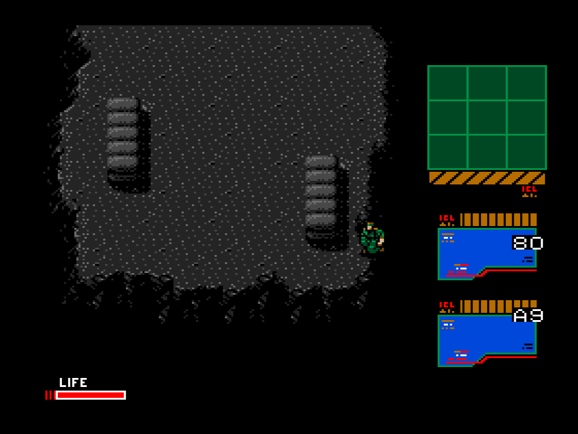

### Sin pausa: moverse por el mapa

| Tecla | Qué hace | |
|---|---|---|
| 8, 2, 4, 6 (teclado numérico) | Snake sale por arriba, abajo, izquierda o derecha, si en el mapa de 0xD900 hay sala allí | visto (el 8) |
| 0-9, A-J | Pone la zona 0x00-0x13 en la casilla de encima del mapa y sale por arriba | visto (el 5): no funciona limpio |
| ; y ] | Suben y bajan la fase de la partida (0xCA22, de 0 a 8) | leído |

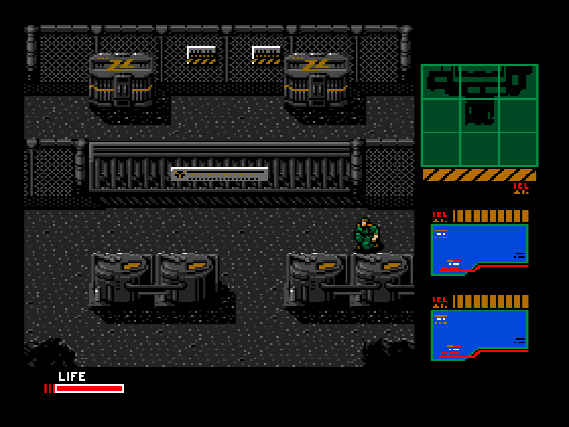

Con el 5, la zona pasa a 5 pero la sala queda en 0x85 y luego en 0xFF, y la
pantalla no se rehace. En esta prueba el salto de zona no llega a una sala
válida; si en el juego acabado le falta algo, o si espera otro estado de
partida, no está comprobado.

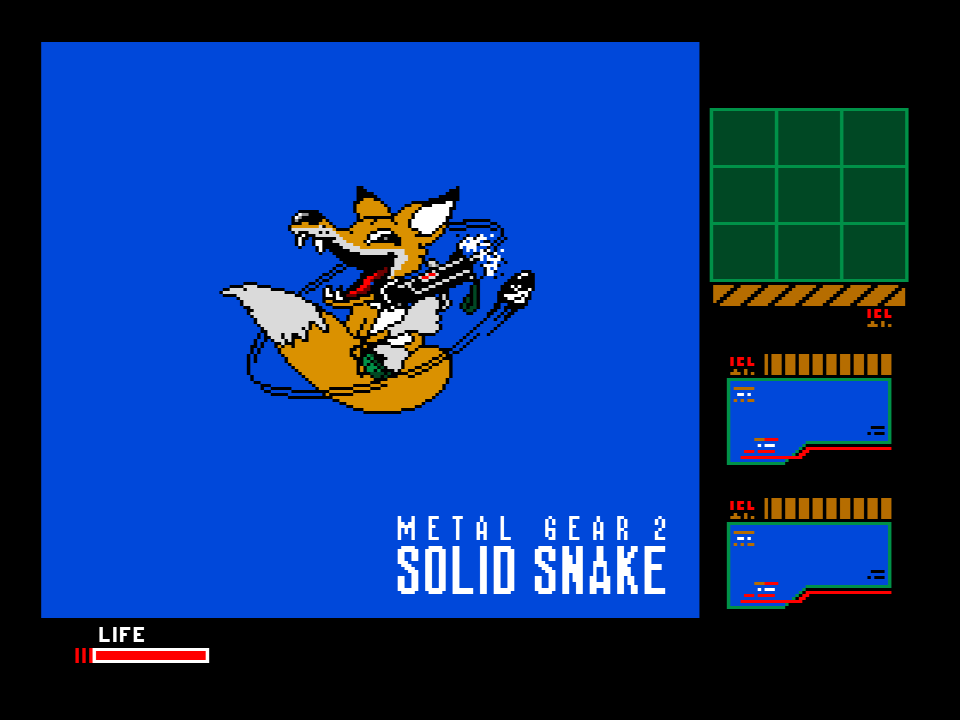

### En la pausa

| Tecla | Qué hace | |
|---|---|---|
| 0, 1, 2, 3 | Enseña esa página de la VRAM | visto |
| arriba / abajo | Desplaza la pantalla en vertical (R#23) | visto |
| TAB | Visor de sprites | visto |
| HOME | Cursor con sus coordenadas | visto |
| ESC | Sale de la pausa y deja todo como estaba | visto |

La página 3 tiene la fuente y los dibujos de las armas y el equipo. La página
2, trozos de los dibujos de las salas. La página 0 aún guarda la
pantalla de la presentación:

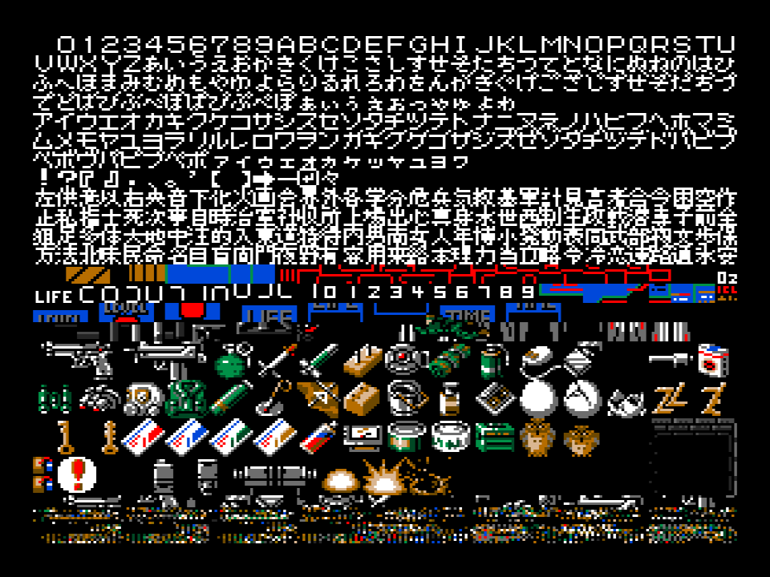

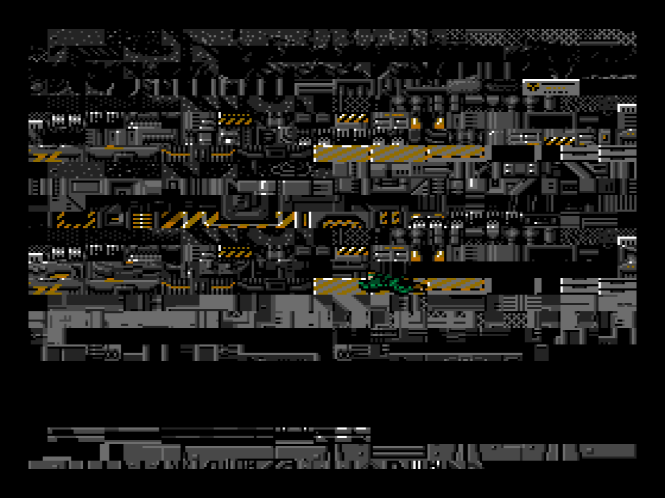

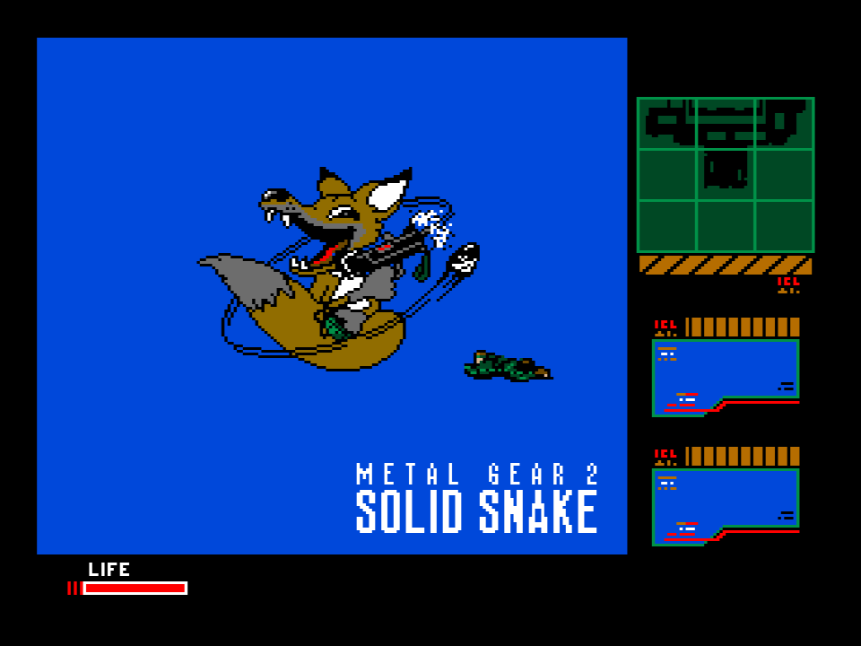

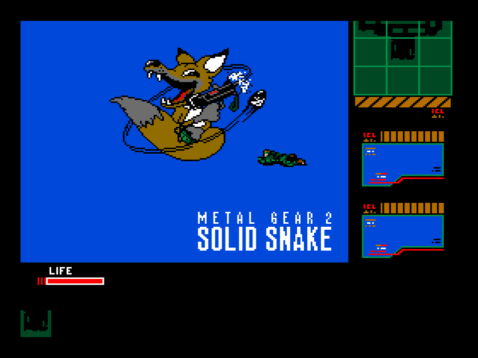

**TAB, el visor de sprites.** Pone los sprites a 16 × 16 al doble (R#1 =
0x63), saca los sprites 0 y 1 dentro de dos marcos y escribe sus patrones
al lado. Con arriba y abajo los patrones avanzan o retroceden de 8 en 8.

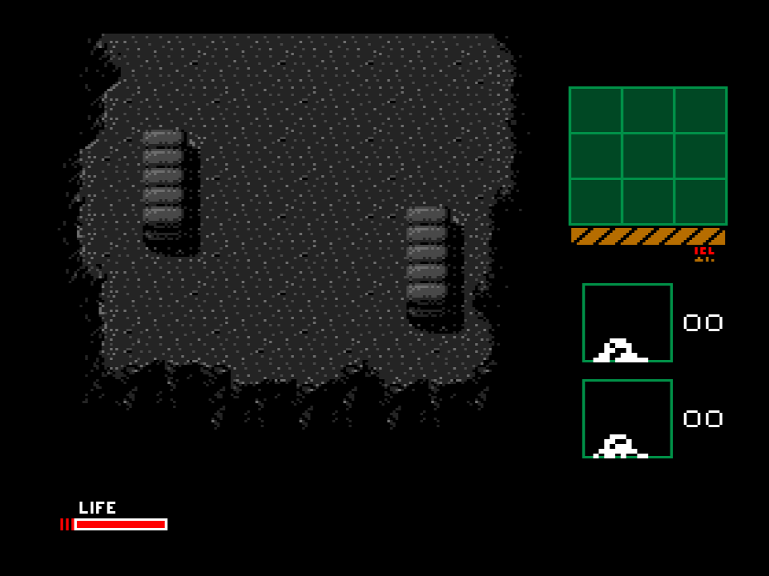

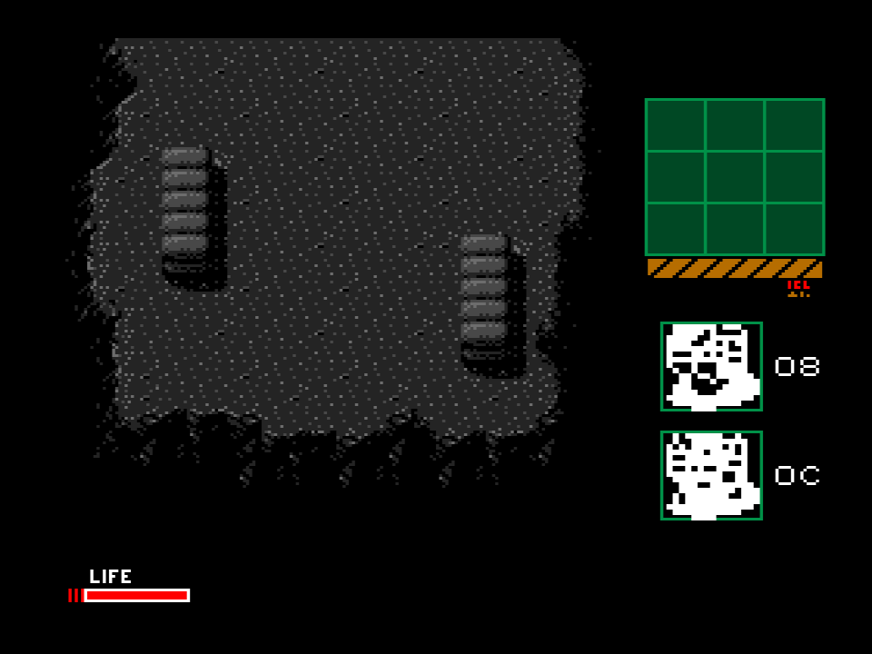

**HOME, el cursor.** Un sprite (el 4, patrón 0x18) que se mueve con las
flechas y cambia de color en cada cuadro. Su Y + 1 y su X se escriben en los
recuadros de la derecha, y así se leen las coordenadas de cualquier punto de
la pantalla.

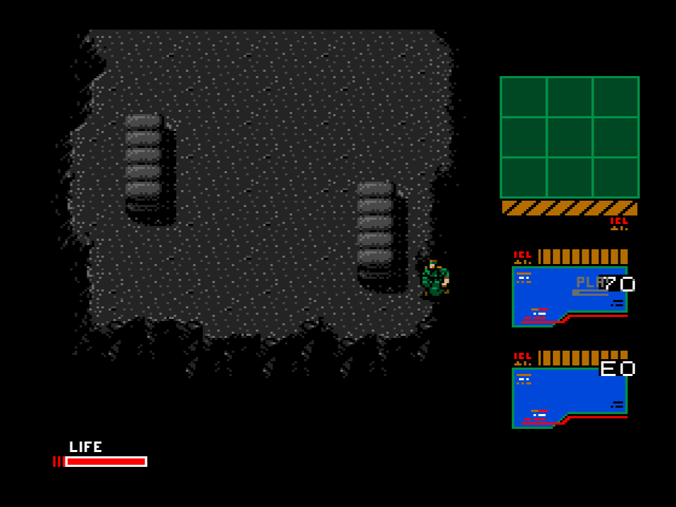

## Lo que no está comprobado

- Lo que hacen en el juego las trampas marcadas como "leído": el listado dice
  qué bytes tocan, pero no se ha mirado jugando qué cambia.
- F2 y F3 (las pantallas de armas y equipo del juego) no se abrieron en la
  primera sala antes de la llamada del transceptor. Por eso Z se ha
  comprobado en la RAM y no en pantalla.
- El salto de zona con 0-9 y A-J (ver arriba).

Las rutinas están comentadas en `src/metalgear2_p63.asm`, desde
`depuracion_apagada` (0xB800) y `monitor` (0xB802).
